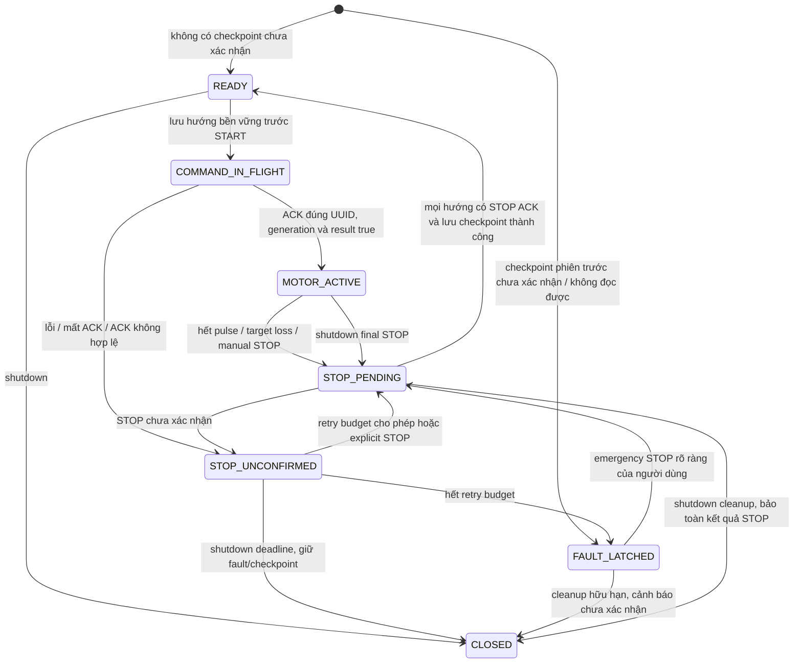
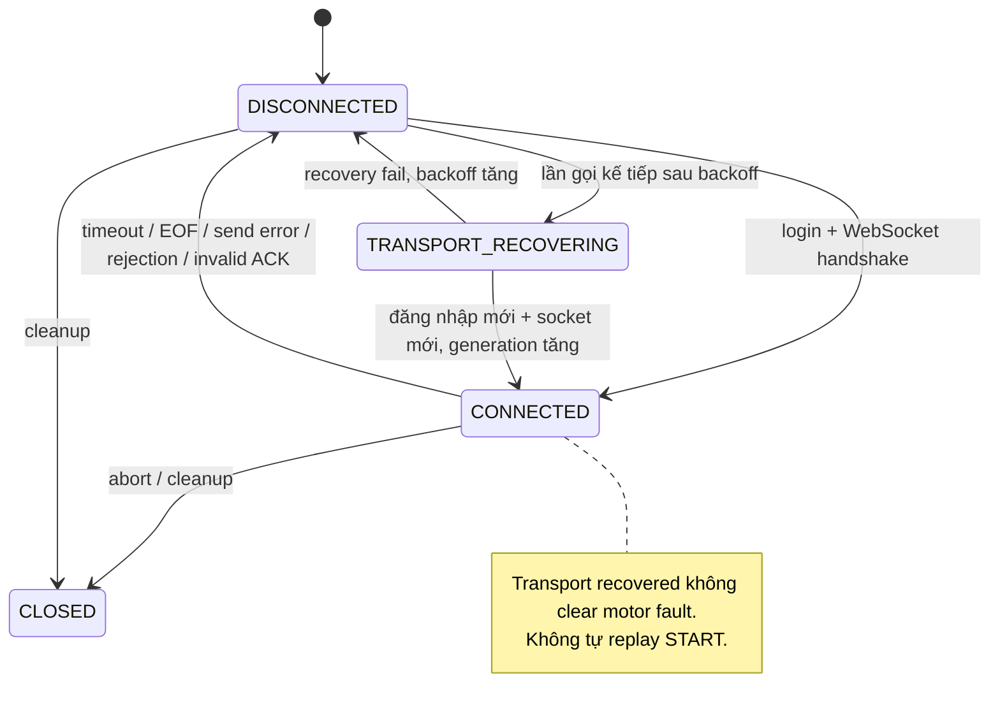

# HANET P0 — transport recovery, STOP fault và shutdown

Ngày thực hiện: **13/11/2026, UTC+7**. Sửa trực tiếp source, chỉ chạy test offline. Không gửi lệnh camera thật, không ngắt mạng thiết bị, không thay tracking hoặc thông số motor.

**Kết quả phần mềm trong phạm vi hotfix:** 37/37 fault-injection tests PASS; regression chọn lọc 232 PASS, 1 SKIP do thiếu GI cho Python 3.10. Full suite: 506 mục, 504 PASS, 2 ERROR do môi trường GI/GStreamer. Không gọi full suite là PASS. Sáu test GStreamer lifecycle/read-only chạy riêng bằng Python hệ thống PASS; các kiểm tra decoder/GstVideo đầy đủ vẫn bị thiếu dependency. **Chưa nghiệm thu phần cứng.**

Artifacts: [baseline](hanet_transport_fault_fix_20261113/baseline_tests.log), [fault tests](hanet_transport_fault_fix_20261113/fault_tests.log), [fault JSON](hanet_transport_fault_fix_20261113/fault_results.json), [regression](hanet_transport_fault_fix_20261113/regression_tests.log), [regression JSON](hanet_transport_fault_fix_20261113/regression_results.json), [full suite](hanet_transport_fault_fix_20261113/full_tests.log), [GStreamer lifecycle](hanet_transport_fault_fix_20261113/gstreamer_lifecycle_tests.log), [GStreamer đầy đủ trên Python hệ thống](hanet_transport_fault_fix_20261113/gstreamer_system_tests.log).

## A. Root Cause Analysis

Đã đọc [báo cáo phiên lỗi](ai_ptz_current_status_20261112_125526.md), app log/JSONL, camera log cùng `.1`, latency trace cùng `.1/.2/.3`, readable trace cùng `.1`, và zoom trace để đối chiếu ownership. [Evidence JSON và SHA-256](hanet_transport_fault_fix_20261113/source_evidence.json) lưu kết quả trích xuất.

| Hiện tượng | Root cause / nhận định | Evidence | File/function | Confidence |
|---|---|---|---|---|
| Lỗi đầu tiên 12:57:30.241 | Chưa biết camera/network/session nào gây lỗi; stale socket chỉ là giả thuyết cho lỗi đầu tiên | Readable còn `PAN_TILT_WIRE_ERROR`, command `pan_99fa1b9cae224762a182f7fa68c90d30`; payload đầu tiên đã rotate mất | `HanetController.command`, log readable `.1` | **Unverified** nguyên nhân kích hoạt |
| Lỗi transport không tự phục hồi | `_ws` khác None dù send/recv đã lỗi; lần sau bỏ qua connect | Source cũ và baseline `test_broken_socket_invalidated` FAIL | `HanetPTZClient.motion`, `_connect_websocket` | **Confirmed** lỗi lifecycle |
| Có thể chấp nhận ACK không hợp lệ | ID trùng và không có error/result=False là đủ; thiếu `result` vẫn return bình thường | Baseline `test_missing_result_is_not_ack` FAIL | `_receive_response` | **Confirmed** lỗi parser; chưa chứng minh xảy ra trong phiên cũ |
| STOP lặp kéo dài | Worker fault không có retry budget, sleep 250 ms rồi thử lại | **1.731/1.731** STOP trong JSONL còn giữ: `STOP_RETRY`, false, `HANET STOP unconfirmed` | `AutoPanTiltController._run`, `_stop` | **Confirmed** |
| Zoom bị chặn | Pan giữ lease sau STOP thất bại, đúng chủ đích bảo vệ | 106/106 decision còn giữ: auto disabled, owner pan_tilt; **267** lần `OWNER_pan_tilt` sau lỗi | `ControlOrchestrator`, auto pan/zoom | **Confirmed; phải giữ** |
| Shutdown không xong | `_closed` chỉ được xét khi không fault, GUI gọi `close(timeout=None)` và tiếp tục poll vô hạn | Baseline close FAIL; shutdown 12:58:49, STOP còn đến 13:05:08, kết thúc KeyboardInterrupt | `AutoPanTiltController._run/close`, `CCTVApp.on_close` | **Confirmed code defect**, không có thread dump phiên cũ |
| Emergency STOP bị owner cản | Manual STOP dùng cùng bước acquire lease, chờ tối đa 20 s rồi có thể bỏ qua | Source cũ; test emergency bypass và pending START mới | `ManualController._run/request` | **Confirmed code defect**, chưa xác minh tác động trong phiên cũ |
| Zoom STOP cũng có nguy cơ spam | Motor worker retry mỗi 100 ms khi busy còn true | Source audit, test 100 yêu cầu STOP chỉ phát 5 lần | `AutoZoomController._zoom_worker`, `_stop` | **Confirmed code defect**, không quy cho 1.731 pan STOP |
| Cleanup lỗi không rõ | RPC close bỏ qua lỗi; controller không đóng lane nếu final STOP fail | Source cũ, fault-injection cleanup/abort failure | `HanetPTZClient.close`, `HanetController.close` | **Confirmed** |

Camera-control log cũ chủ yếu chứa camera transaction, không giữ nguyên nhân PAN wire đầu tiên. Sự kiện `RTSP_DISCONNECTED` trong lúc close cũng xảy ra với dừng chủ động; không suy thành nguyên nhân mạng của sự cố PTZ.

## B. Fault Lifecycle

`READY` là trạng thái logic cho phép lệnh; **không phải telemetry chứng minh motor vật lý đang đứng yên**. Transport và motor có trạng thái riêng.





| Tình huống | Xử lý và bằng chứng |
|---|---|
| Login/connect thất bại trước transmission | Không replay START. Log `transmission=not_attempted` khi đã vào RPC motion; lỗi factory trước motion không có START wire. Controller có thể giữ hướng một cách bảo thủ nếu đã chuẩn bị lệnh |
| Sendall lỗi hoặc gửi một phần | `attempted_unknown`, không suy camera chưa nhận; giữ hướng và yêu cầu STOP |
| START đã gửi, mất ACK | `sent`, motor uncertainty, không START lần hai; STOP theo policy |
| START ACK | Chỉ boolean `result: true`, matching UUID, generation hiện tại; chuyển MOTOR_ACTIVE |
| STOP gửi lỗi / mất ACK | Giữ hướng, fault và ownership; invalidate transport, backoff |
| Explicit failure hoặc response không đúng schema | Không ACK, invalidate/re-auth ở lần thử sau; không đoán mã lỗi vendor là session expiry |
| Session hết hạn / heartbeat lỗi | Bỏ session cũ; login digest mới qua protocol sẵn có, không replay START |
| WebSocket đóng khi command đang chạy | EOF/close frame/send failure đều khiến connection bị bỏ và buffer được xóa |
| ACK muộn | Request UUID duy nhất, socket/buffer cũ bị bỏ, transaction lock ngăn hai reader/reconnect cạnh tranh; generation/closed được kiểm tra trước chấp nhận kết quả |
| Camera không phản hồi / timeout | Deadline monotonic và socket timeout; giữ trạng thái không chắc chắn |
| Reconnect thành công nhưng STOP false | Motor vẫn fault; không zoom/manual START |
| Shutdown khi active/fault | Ngừng admission START, ưu tiên STOP, hạn chờ hữu hạn; cleanup không biến unconfirmed thành safe |

## C. Source Code Changes

[Manifest và hash](hanet_transport_fault_fix_20261113/change_manifest.json) và [patch đầy đủ](hanet_transport_fault_fix_20261113/hotfix.patch).

| File | Hàm/lớp và thay đổi trước → sau |
|---|---|
| `camera/hanet_rpc.py` | `motion`, `_connect_websocket`, `_recv_exact`, `_receive_response`, `heartbeat`, `abort`, `close`: socket stale → invalidate/close; RLock một transaction; generation tăng; login lại sau lỗi; backoff; deadline; frame limit; ACK explicit; sanitized exception/errno; cleanup có kết quả |
| `camera/hanet_controller.py` | `command/stop/close`: active codes và fault → state machine rõ ràng, budget chung, explicit ACK, checkpoint trước START, STOP ACK mới xóa hướng, shutdown gate/watchdog, cleanup lane kể cả STOP fail |
| `runtime/stop_retry.py` (mới) | `StopRetryBudget`: clock có thể inject, tối đa 5 lần thử, backoff `.5, 1, 2, 4` giây; exhaustion không phải recovery |
| `runtime/camera_worker.py` | `call/_run/close`: queue thường 16 + queue ưu tiên 16; coalesce STOP cùng loại; STOP hủy movement đang chờ; không hủy command đang I/O bằng suy đoán; bounded wait; cancel START chưa chạy khi hết hạn; nested call vẫn inline để tránh deadlock |
| `control/auto_pan_tilt.py` | `_run/_stop/close`: fault loop vô hạn → budget, Condition.wait có thể ngắt, kiểm tra close ở mọi trạng thái; external STOP ACK có thể giải phóng owner; auto vẫn disabled sau phục hồi |
| `control/auto_zoom.py` | `_stop`, vòng retry sau motion, `close`: giới hạn retry/log, giữ busy và owner khi chưa xác nhận, join dùng ngân sách còn lại; không sửa framing/pulse/recovery policy |
| `control/manual.py` | `request/_run`: STOP mailbox riêng không bị START ghi đè, bypass ownership cho STOP; recheck fault sau dequeue chặn START đến trong lúc STOP đang chờ ACK |
| `control/orchestrator.py` | `begin_shutdown/acquire/blocked`: đóng admission toàn bộ lease mới; timeout/reconnect không release lease |
| `runtime/shutdown.py` (mới) | `close_controls`: thứ tự teardown, ngân sách monotonic, báo cleanup failure và unconfirmed rõ ràng |
| `gui/cctv_app.py` | `on_close`: bỏ join/poll vô hạn, freeze admission ngay ở Tk, cleanup ở thread, watchdog GUI 15 s + tối đa 2 s flush log; cảnh báo nguy cơ motor còn chạy |
| `telemetry/latency.py` | `event/_write`: structured HANET/pan/motor/shutdown vào camera log; first-failure snapshot độc lập với rotating trace và queue frame đầy; I/O log ở writer thread |
| Tests/harness | Hai module fault/shutdown mới, runner chặn network/video; 3 test module cũ chỉ cập nhật mock ACK explicit/recovery call |

**Retry:** controller và supervisor có budget riêng; một lần bị từ chối bởi backoff có thể tiêu budget supervisor. Không có loop reconnect bên trong `motion`. Backoff transport từ 0,5 s đến 8 s. Hết budget vẫn khóa motor; explicit emergency STOP cho phép một lần thử ngoài budget tự động, nhưng vẫn tôn trọng backoff transport. Shutdown có manual STOP và final STOP có giới hạn, không mở một vòng retry mới.

**Checkpoint motor:** mặc định `ptz/logs/camera/motor_state/<hash-host-port>.json`, neo theo vị trí module, không phụ thuộc cwd. Chỉ chứa version và command codes, không credential. Lưu atomic + fsync trước START; xóa từng hướng chỉ sau STOP ACK và cập nhật file thành công. Khởi động lại nạp hướng còn lại vào FAULT_LATCHED. File không đọc được thì fail-closed với các hướng đã biết. Không có file cũ không chứng minh trạng thái vật lý của camera; lần triển khai đầu tiên cần xác minh trực tiếp theo guide. Không hỗ trợ nhiều tiến trình cùng điều khiển một thiết bị.

**Compatibility/config:** không thay `camera.json`, `config.py` hay tuning motor. Không thêm nút bật “bypass safety”. Có tham số constructor `safety_state_path` để fixture dùng thư mục tạm. `HanetPTZClient.motion()` nay trả `True` khi ACK hợp lệ, không dựa vào return bình thường/None; fake backend phải cung cấp ACK explicit. Parser cố ý fail-closed với ACK schema chưa xác minh. `AutoPanTilt.close(None)` nay tối đa 6 s join; backend close và GUI không hiểu None là chờ vô hạn. Đóng RPC không gửi logout network round trip; session được invalidated cục bộ và chờ thiết bị hết lease.

**Logging:** wall-clock, monotonic, context command ID và RPC UUID, generation, operation/code, timeout, exception type/message đã loại credential, errno, ACK, retry attempt, owner/fault/phase được ghi tại tầng biết giá trị đó. Trường không có bằng chứng để trống, không bịa owner/session. Không log Auth token hoặc payload đăng nhập. `first_failures_<run>.json` giữ lỗi đầu tiên của từng nhóm quan trọng trong phiên, không bị trace rotation ghi đè, giữ tối đa 20 phiên. Logging này dùng profiler được bật trong cấu hình hiện tại; không sửa cờ profiling. Motor checkpoint vẫn độc lập với profiler. Disk fsync checkpoint nằm trước START và có thể thêm độ trễ lưu trữ; chưa benchmark phần cứng, không thay speed/pulse để bù.

## D. Independent Test Results

Trước sửa: **3/3 baseline FAIL** đúng lỗi stale socket, missing-result ACK và shutdown fault. Sau sửa: **37/37 PASS**, gồm 16 tình huống yêu cầu và các test bổ sung về queue, restart, cleanup, GUI, backoff/flood.

| Test | Expected | Actual | PASS/FAIL |
|---|---|---|---|
| 1 Normal START/STOP | ACK đúng, lease được release | 1 START + 1 STOP, READY, owner None | PASS |
| 2 START timeout | Không replay START, safe STOP | Chỉ 1 START; STOP sau recovery xác nhận | PASS |
| 3 STOP timeout | Fault giữ, chặn START | Pan/zoom/manual entrypoint đều bị backend từ chối | PASS |
| 4 WebSocket closed | Invalidate, reconnect có kiểm soát | Socket cũ đóng, generation 2, 2 connection tổng | PASS |
| 5 Stale socket | Không retry trên socket lỗi | 50 lần trong backoff không thêm send/connect | PASS |
| 6 Session expired | Re-auth, không replay START | Login lại 1 lần; connection mới chỉ gửi STOP | PASS |
| 7 Late ACK | ACK cũ không xác nhận STOP mới | ACK UUID cũ bị bỏ; STOP mới false vẫn fault | PASS |
| 8 STOP false liên tục | Retry hữu hạn, fault giữ | 100 yêu cầu → tối đa 5 STOP wire/fake backend calls | PASS |
| 9 Reconnect OK, STOP false | Transport không đồng nghĩa motor safe | Generation tăng, fault/START block còn nguyên | PASS |
| 10 STOP eventually confirmed | Clear fault đúng điều kiện | Explicit STOP sau exhaustion clear fault; lệnh mới chỉ được nhận sau đó | PASS |
| 11 Shutdown fault | Hữu hạn, không deadlock | Worker pan/manual/camera đều thoát, owner giữ và báo unconfirmed | PASS |
| 12 Pan fault + zoom | Zoom không START | 8 acquire đồng thời đều false; backend chặn zoom | PASS |
| 13 Manual emergency STOP | Không chờ owner, không mất request | STOP chạy khi pan giữ lease, pending STOP không bị START thay thế | PASS |
| 14 Cleanup failure | Ghi lỗi, không crash/hang | RPC close/abort failure được log đã sanitize; lane thoát, kết quả cleanup false | PASS |
| 15 Reconnect fail lặp | Backoff + finite budget + shutdown | 100 request không làm connect vô hạn, fault giữ; close hoàn tất | PASS |
| 16 Nhiều thread STOP | Không race state hoặc nhiều connection | 12 caller qua controller: một STOP wire; 12 caller trực tiếp client: một connection, ACK tuần tự | PASS |

Bổ sung: fake clock kiểm tra `.5/1/2/4` và exhaustion; fake Condition chứng minh worker fault ngủ chờ thay vì spin, 10 lần thức sau exhaustion không tăng số STOP; kiểm tra first failure qua rotation; START queue timeout/STOP priority; fault khi restart; START đến trong lúc emergency STOP thất bại; shutdown watchdog; GUI deadline; không dùng None/Mock truthiness làm ACK. Test concurrency dùng Event/barrier và timeout có giới hạn, không dùng sleep để giả lập retry nhiều giây.

Lệnh tái lập, từ gốc `ptz/`:

```bash
/home/admin1/miniconda3/envs/py/bin/python tools/run_hanet_fault_tests.py \
  --json docs/hanet_transport_fault_fix_20261113/fault_results.json
/home/admin1/miniconda3/envs/py/bin/python tools/run_hanet_fault_tests.py --regression \
  --json docs/hanet_transport_fault_fix_20261113/regression_results.json
/home/admin1/miniconda3/envs/py/bin/python tools/run_unit_tests.py
```

Hai lệnh harness đầu chặn live socket, HTTP và VideoCapture; fixture chỉ dùng fake. Lệnh full suite dùng runner hardware-free hiện có của repository. Không chạy `main.py`, camera diagnostics, calibration hoặc motion script.

## E. Shutdown Validation

- Ca mock fault đo **0.002112 giây**, với STOP không xác nhận. Worker `auto-pan-tilt`, `manual-motor`, `camera-command`: **0 thread còn sống** khi test kết thúc. Đây là thời gian mock, không phải dự đoán latency camera thật.
- Fake GUI clock: controller/RTSP không bao giờ báo done vẫn đi đến destroy trong **≤17,1 s** mô phỏng (15 s cleanup + 2 s log flush). Tk không join network worker.
- Ca RPC đang chạy: watchdog gọi abort I/O; resource close sau đó trên đúng lane; không còn START trễ; test join kiểm tra lane và watchdog đều kết thúc.
- Thứ tự: freeze leases/START → tắt auto pan/zoom/focus và enqueue manual emergency STOP → join pan, zoom, focus, manual theo ngân sách còn lại → final STOP và close RPC trong camera lane → cancel queue và kết thúc lane. RTSP dừng song song để GStreamer teardown không trì hoãn motor STOP. AI/face join hữu hạn; log writer flush hữu hạn trước GUI destroy.
- STOP không xác nhận không release owner để “đóng cho xong”. Orchestrator `closing=True` từ lúc nhận close, nên ngay cả STOP ACK cuối làm owner được giải phóng cũng không mở lệnh mới.
- `SHUTDOWN_STOP_TIMEOUT`, `SHUTDOWN_COMPLETED_WITH_UNCONFIRMED_MOTOR` và cảnh báo tiếng Việt không dùng từ “motor stopped”. Nếu hết hạn, GUI/log nói rõ cần kiểm tra trực tiếp hoặc cơ chế dừng độc lập.
- Không có deadlock/thread leak trong các test đã chạy. Python không thể cưỡng bức kết thúc một thread mắc kẹt trong native driver/OS hoặc backend tùy biến không tuân thủ timeout; GUI vẫn có giới hạn thoát, checkpoint không bị xóa. Chưa xác minh shutdown timing trên mạng/phần cứng thật, DNS treo hoặc HTTP server gửi dữ liệu nhỏ giọt.

## F. Motor Ownership Validation

- STOP timeout/rejection giữ `_active_codes`, `_motor_fault`, trạng thái fault và lease pan/zoom. Reconnect không gọi release.
- Backend chặn mọi START, gồm manual và zoom không có telemetry. Orchestrator chỉ là một lớp bảo vệ; không phải lớp duy nhất.
- Emergency STOP đi qua queue ưu tiên, bypass acquire; không “cướp rồi giải phóng” lease của chủ khác. Supervisor chủ lease chỉ release sau kết quả STOP đã được xác nhận.
- Pan/zoom fault đã hết budget có thể nhận biết backend trở lại READY sau explicit STOP và hoàn tất bookkeeping; auto-pan vẫn disabled để tránh tự resume theo target cũ.
- Manual START đến trước khi STOP trả false được recheck sau dequeue; không vượt fault latch.
- Chờ manual lease vẫn có deadline riêng 20 s và bị ngắt bởi request mới/close; hết thời gian không chứng minh motor safe. STOP không phải chờ deadline ownership đó.
- Startup checkpoint giữ uncertainty qua restart. Đóng ứng dụng không xóa latch chưa xác nhận.

Regression trong phạm vi: normal auto pan, normal auto zoom, manual, arbitration, target loss STOP, OpenCV RTSP disconnect/retry/cleanup, GUI deadline, zoom recovery không telemetry, restart fault và cleanup ordering đều có test đã chạy đạt. Kiểm tra GStreamer legacy trong Python AI bị dependency block, được báo riêng thay vì gán PASS. [Hash bảo vệ](hanet_transport_fault_fix_20261113/protected_files.json) xác nhận **23 file** AI/config/pan/zoom policy không đổi: không chỉnh YOLO, ByteTrack, OSNet, overlap gate, ReID threshold, face recognition, speed, pulse, deadzone hoặc zoom ratio.

## G. Remaining Hardware Uncertainty

1. Không xác định được nguyên nhân gốc của lỗi START 12:57:30.241 vì payload đã mất. Hotfix xử lý các failure path đã tái hiện, không tuyên bố stale WebSocket là sự kiện kích hoạt chắc chắn.
2. ACK schema firmware thật chưa được thu lại trong lượt này. Boolean `result: true` được test; response khác fail-closed cho đến khi có mẫu được xác minh.
3. STOP theo direction trên session mới được dùng theo semantics hiện có; tác dụng vật lý, tính idempotent trên firmware và việc một session mới có dừng được movement từ session trước cần hardware validation.
4. Không có telemetry motor/position HANET. ACK không chứng minh đứng yên, đã về wide limit hay quãng đường chuyển động.
5. Checkpoint không bao phủ lệnh từ ứng dụng khác hoặc sự cố xảy ra trước triển khai; không được xóa/đổi camera identity để bypass fault. Không chạy nhiều process điều khiển cùng camera.
6. Chưa đo fsync/network/GUI trên máy vận hành thật. Dependency GStreamer thiếu được giữ nguyên, không sửa môi trường CUDA/AI để làm suite xanh.

## H. Hardware Validation Guide

Hướng dẫn riêng: [hanet_hardware_validation_20261113.md](hanet_hardware_validation_20261113.md). Bao gồm người giám sát, vùng an toàn, speed/pulse nhỏ có phê duyệt, cơ chế STOP độc lập, video đồng bộ log, quan sát STOP vật lý, session/reconnect và restart fault. **Chưa tự thực hiện bất kỳ bước phần cứng nào.** Không tự ngắt mạng hay cố tình tạo fault trên camera.

## I. Rollback

Lúc bắt đầu, cả thư mục ngoài và gốc `ptz/` đều **không có Git repository**. Không tạo lại hoặc ghi đè lịch sử của người dùng. Đã tạo Git checkpoint riêng cho source/test liên quan:

- Path: `/mnt/files/Project/ptz/.hotfix_checkpoints/hanet_20261113`
- Commit: `8887d4dc92bcf63fea78e1e90abb212d20ce242b`
- [Checkpoint metadata](hanet_transport_fault_fix_20261113/checkpoint.json), [manifest](hanet_transport_fault_fix_20261113/change_manifest.json), [patch](hanet_transport_fault_fix_20261113/hotfix.patch), [diff stat](hanet_transport_fault_fix_20261113/diff_stat.txt).

Đã chạy [rollback script](hanet_transport_fault_fix_20261113/rollback.py) ở chế độ **dry-run**. Script kiểm hash toàn bộ file trước khi restore, từ chối nếu có chỉnh sửa sau hotfix; giữ nguyên log, checkpoint motor, credential, config và báo cáo.

```bash
# Chỉ xem danh sách hoàn tác:
python docs/hanet_transport_fault_fix_20261113/rollback.py

# Sau khi người phụ trách đã xác minh camera dừng an toàn và ứng dụng đã đóng:
python docs/hanet_transport_fault_fix_20261113/rollback.py --apply
```

Hoàn tác riêng một file: lấy đúng blob `git -C <checkpoint_path> show <commit>:<relative_path>` sau khi kiểm tra hash và sao lưu thay đổi mới của người dùng. Các module controller/worker/shutdown liên quan chặt chẽ; ưu tiên rollback đồng bộ toàn bộ hotfix. Không xóa motor checkpoint chỉ để mở khóa. Source cũ không biết checkpoint mới và tái tạo lỗi shutdown/retry; **không rollback để tiếp tục điều khiển khi trạng thái motor vẫn chưa xác nhận**.
