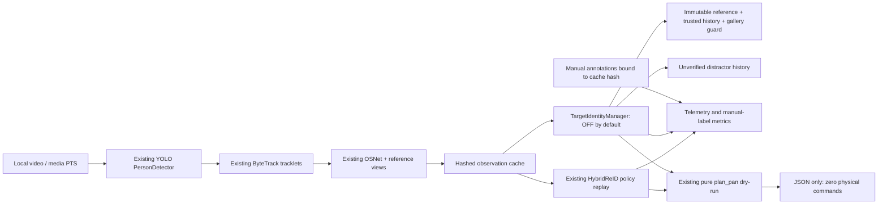

# Identity-preserving PTZ — Phase 0/1, 2026-11-19

Đã triển khai Phase 0 replay/telemetry và Phase 1 `TargetIdentityManager` **offline, mặc định OFF**. Đã chạy YOLO/ByteTrack/OSNet thật trên video có sẵn và 185 test liên quan. Chưa có chứng cứ giảm ID switch, target loss hoặc recovery latency. Candidate giữ HOLD nhiều hơn baseline; chưa đủ điều kiện đưa vào production. Không kết nối camera, không chạy motor, không sửa controller production.

## Baseline và phạm vi thay đổi

- Git root: `/mnt/files/Project/ptz/ptz` (thư mục cha không phải repository).
- SHA: `ede31989fe6a39b04d7cd4d31675ebd811a28397`.
- Nhánh ban đầu: `baseline/verified-pre-async-20261116`.
- Nhánh làm việc: `work/identity-phase01-20261119`; thay đổi mới chưa commit.
- Working tree ban đầu **không sạch**: `ai/hybrid_reid.py`, `ai/overlap_policy.py`, `config.py` đã sửa; nhiều docs/log/model/tool chưa track. Baseline thực nghiệm là **SHA + working tree đã lưu**, không phải riêng SHA.
- Snapshot trước sửa: `../../../validation/identity_phase01_baseline/`: `status.txt`, `working_tree.patch`, `HEAD`, `branch.txt`, `source_hashes.json`, `source_before.tar.gz` (201 tệp source/config), ba bản sao tệp đã sửa. Không reset/clean/stash hoặc ghi đè thay đổi của người dùng.
- `change_manifest.json` ghi checksum trước/sau; `source_integrity.json` xác minh mọi source cũ ngoài `config.py` còn nguyên byte. Config chỉ thêm hai cờ OFF ở cuối; mọi giá trị threshold cũ giữ nguyên.

Tệp mới:

| Tệp | Vai trò |
|---|---|
| `ai/target_identity.py` | Identity memory, provenance, states, confirmation, gallery guard, decision audit |
| `tools/identity_replay.py` | Video → shared evidence cache; baseline/candidate replay; annotation template; ảnh review; pure pan dry-run |
| `tools/identity_metrics.py` | Metric theo nhãn thủ công và khoảng thời gian PTS |
| `test/test_target_identity.py` | 17 test identity |
| `test/test_identity_replay.py` | 6 test replay/metric/flag/network/provenance |
| `tools/rollback_identity_phase01.py` | Rollback có checksum, mặc định dry-run |
| `docs/identity_phase01/*` | Báo cáo, log test, evidence cache, so sánh, annotation template, ảnh review |

Tệp cũ sửa trong nhiệm vụ này: chỉ `config.py`, thêm `IDENTITY_MEMORY_ENABLED = False` và `IDENTITY_MEMORY_GALLERY_ENABLED = False`. Diff của hai tệp `ai/hybrid_reid.py` và `ai/overlap_policy.py` là thay đổi **đã có trước nhiệm vụ**, không thuộc implementation mới.

## Mapping code và audit có dẫn chứng

| Thành phần | Tệp / hàm hiện tại | Kết luận |
|---|---|---|
| Capture | `camera/rtsp_player.py`; `gui/cctv_app.py:on_frame`; `runtime/frame_manager.py:publish/latest` | Timestamp monotonic được gắn lúc decoded frame đến ứng dụng. `capture_timestamp` mặc định `None`; không phải sensor exposure timestamp. Mailbox một slot, frame_id tăng, consumer lấy frame mới. |
| Detection | `app/application.py:initialize_models`; `ai/detector.py:YOLODetector.detect` | PersonDetector nhận confidence thấp cho ByteTrack; `model.predict` thực hiện YOLO, không đổi model/weights. Config imgsz=640, person conf=.35, ByteTrack low=.10. |
| MOT | `runtime/byte_tracking.py:ByteTrackPersonTracker.update`, `IndexedByteTracker.init_track` | Map native IDs sang ID ứng dụng; giữ source detection index. Reject thời gian lùi, reset sau gap. Native Kalman cập nhật theo lần update, không dùng dt PTS liên tục; không đủ để kết luận ByteTrack xử lý pan/zoom đúng. |
| OSNet | `person_search/reid.py:OSNetReID.extract_embeddings`; `ai/reid_target.py:_score_batch`; `ai/reid/gallery.py` | Embedding 512-dim normalized; gallery baseline gồm biến thể **ảnh tham chiếu**, không phải gallery online. Score max qua views; raw/illumination-normalized fusion theo config. |
| Confirmation | `ai/reid_target.py:select_person`; `ai/hybrid_reid.py:acquisition_allowed/_select_person` | Threshold acquire=.65, keep=.50, reacquire=.70, margin=.08, confirmations=3. Acquisition và recovery yêu cầu geometry/time; hybrid còn yêu cầu cùng MOT ID khi tích lũy confirmation. |
| Continuity / identity | `ai/hybrid_reid.py:reset/_select_person/_take_verification` | Baseline **đã có target_uid**, giữ UID khi rebound track_id. Vì vậy “chưa có UID độc lập” không phải root cause chính. Trong continuity, giữ cùng track_id + IoU + bounded prior positive evidence cho phép return current giữa hai lần verify. Reused ID có cửa sổ chưa phát hiện, không thể coi ID ổn định là đúng người. |
| Overlap | `ai/hybrid_reid.py:_candidate_overlap/_select_person`; `ai/overlap_policy.py:OverlapMemory.assess/minor_contact` | Khi mọi candidate bị gate overlap, bỏ OSNet, xóa confirmation, HOLD. Minor/temporal overlap đã có và đang ON ở dirty baseline. Không nhân bản hay vô hiệu hóa các policy này trong production. |
| HOLD / loss / recovery | `ai/hybrid_reid.py:_hold/_select_person`; `ai/reid_target.py:finish_frame/mark_lost/reset` | Missing current ID, overlap, IoU jump, verify timeout, low ReID hoặc margin yếu dẫn HOLD. Sau thiếu observation đủ số frame **và** grace time, reset preserve_reacquire. Recovery dùng cùng pending track_id + IoU + max gap; ID churn có thể kéo dài confirmation dù appearance vẫn đúng. |
| Async result safety | `ai/hybrid_reid.py:_start_verification/_take_verification`; `runtime/inference_worker.py:consume_identity/ai_worker` | Baseline đang có một job verification thread bounded; tên nhánh “pre-async” không mô tả hết code hiện tại. Token epoch/session/track và age chặn job cũ. Result được phép từ frame trước trong giới hạn 2s; không phải freshness frame hiện tại. Sau selection runtime kiểm tra wall-clock age lần nữa trước publish authorization. Face result có session/track/geometry/age guard. Không phát hiện bằng chứng để kết luận mọi guard vô hiệu. |
| State cho framing | `control/target_state_machine.py:TargetStateMachine.update` | SEARCH_PERSON/ZOOM_PERSON/SEARCH_FACE/TRACK_FACE/FACE_LOST_HOLD/FACE_RECOVERY/LOST_TARGET là state khác với selector SEARCHING/TARGET_LOCKED/OCCLUDED_HOLD. Không thay enum production. |
| PTZ admission | `runtime/inference_worker.py:ai_worker`; `runtime/target_session.py` | Session chỉ publish khi locked và không crossing_hold; uncertain yêu cầu STOP. Face jobs, pan/zoom còn dùng track_id như **authorization binding**, không chỉ identity. Thay binding tùy tiện sẽ làm hỏng safety. |
| Pan/tilt & safety | `control/pan_policy.py:plan_pan`; `control/auto_pan_tilt.py:submit/_stop`; `runtime/camera_worker.py:CameraCommandWorker.call`; `camera/hanet_controller.py:command/stop` | Busy, cooldown, freshness, session, STOP priority, persisted STOP fault latch và shutdown giữ nguyên. Pure planner được tái sử dụng cho dry-run; không tạo motor controller. |

Các cơ chế có khả năng gây fragmentation/latency được suy ra từ nhánh code, **chưa chứng minh là ID switch theo ground truth**: confirmation phụ thuộc MOT ID; overlap làm mất chuỗi confirmation và chặn appearance; native motion update không theo dt thực; fresh appearance chỉ lấy định kỳ trong continuity; ảnh quay màn hình/occlusion làm score giảm.

Log thật đã đọc trực tiếp: `logs/latency/latency_trace_20261116_115349_764314.jsonl*`. Bản trích có tên tệp, số dòng và checksum nằm trong [historical_log_audit.json](historical_log_audit.json).

- `.jsonl.3:312–313`, frame 2861/2870: ReID .74235, margin .27178; tiếp đó có overlap min-area .20213 với track 51, IoU chỉ .02244. Score cao không xóa geometry policy. Đây là evidence policy/geometry, không chứng minh người nào đúng.
- `.jsonl:1635`, frame 4381: candidate overlap .18698 với một detection confidence .21561; target similarity .51259, margin .03678. Có cả vấn đề appearance và geometry; không thể quy tất cả cho threshold overlap.
- Counter cuối run: receive 29.863 FPS; detection 8.889 FPS; 20 lần `reid_skipped_all_candidates_overlap`, 163 lần throttle HOLD, 6 stale ReID results; 5 loss và 4 recovery do ứng dụng ghi nhận. Đây **không phải** GT identity metrics.
- Timing aggregate của run: YOLO mean 30.10 ms/p95 50.99 ms; ReID total mean 133.98 ms/p95 236.13 ms; receive→inference age mean 16.98 ms/p95 32.47 ms. Các mốc này khác nhau, không cộng/chia tùy ý thành end-to-end FPS.
- Log tháng 11 có thể được tạo bởi source/config trước các dirty changes hiện tại; không gán historical metrics thành benchmark của working tree hiện tại. Không đồng bộ các log này với video quay màn hình để suy ra GT.

## Kiến trúc đã thực thi



Production vẫn: RTSP → YOLO → ByteTrack → HybridReID selector → framing state → controllers → HANET. Module mới **không được import vào runtime/inference_worker**, không thay inference scheduling, không thêm thread. Phase 1 là implementation và integration **offline** có kiểm chứng, chưa phải live integration.

`TargetIdentityManager`:

- `target_uid` và identity `session_id` chỉ đọc, không đổi khi MOT đổi ID. Một frame chỉ có tối đa một selected candidate; khi HOLD active binding là `None`, last trusted binding chỉ là lịch sử.
- Original embedding immutable; các reference views immutable; confirmed gallery lưu từng view riêng, bounded 8; history/tracklet/distractor bounded 128. Những số này là giới hạn bộ nhớ, không phải confidence hiệu chuẩn.
- Last trusted observation gồm bbox, timestamp, embedding, camera-state metadata nếu caller có; velocity tính theo dt timestamp thật. Camera state chỉ được lưu, không tự suy luận pose hoặc áp dụng GMC.
- Six states: CONFIRMED_VISIBLE, VISIBLE_UNVERIFIED, AMBIGUOUS, OCCLUDED_PREDICTED, LOST_IN_FOV, OUT_OF_FOV. Hai state occlusion/out-of-FOV cần evidence explicit của caller; absence không tự chứng minh ra khỏi FOV. OCCLUDED_PREDICTED chỉ là hypothesis visibility, không phát bbox dự đoán hay motor authorization.
- Mỗi match cần fresh appearance + threshold/margin + admissible geometry/confidence. Khi acquire/reacquire cần nhiều observation cùng chuỗi appearance/geometry/time; không bắt buộc cùng track_id. Không dùng weighted confidence tùy ý. Identity/localization/visibility là nhãn evidence, không xác suất.
- Candidate bị policy từ chối vẫn tham gia ambiguity evidence; không lọc đối thủ để tăng margin. Evidence thiếu/cũ của đối thủ làm fail closed. Mỗi MATCH/REACQUIRE/HOLD/REJECT có reason và candidate audit.
- Gallery chỉ thêm crop explicit `quality_approved`, confirmed, không occlusion/overlap, và reference score đạt reacquire threshold. Crop trong video cache chưa review đều `False`. Gallery similarity hiện chỉ là diagnostic: **không tự mở rộng quyền match dựa trên gallery mới**. Cần benchmark có nhãn để thử utility của online multi-view gallery.
- Distractor history ghi `UNVERIFIED_ALTERNATIVE`; không biến candidate khác thành negative identity ground truth. Distractor-aware association đầy đủ thuộc Phase 2, chưa triển khai.
- ReID chứng cứ phải trùng frame/session/timestamp. Frame stale, duplicate, future hoặc out-of-order không thay đổi memory/confirmation/gallery. Local flow không có embedding không thể xác nhận identity.

## Benchmark Phase 0 và Phase 1

Nguồn: `16_11(2).mov`, 1920×1080, frames 0…1195, stride=5, 240 observation, span 39.86833 s. PTS lấy từ decoder; không suy dt từ FPS mặc định. Reference là `person_search/targets/target.jpg` hiện có, chưa được con người xác nhận tương ứng target trong clip. SHA video/reference/model/config/source và environment device được ghi trong [manifest](video_cache/manifest.json).

Đây là **video quay màn hình ứng dụng** (có overlay/UI, perspective, glare), không phải frame RTSP nguyên bản. Không tự cắt/warp video hoặc chọn target theo prediction. Sáu ảnh có candidate_id để review nằm trong `review_frames/`; template `annotations.unreviewed.json` chưa phải GT.

Hai policy dùng chung detection, tracklet, winning raw/normalized embedding và timing extraction. 375 candidate có parity appearance so với scorer baseline; sai số lớn nhất 1.27064e-7 ([kiểm tra](appearance_parity.json)). Không đổi YOLO/OSNet/ByteTrack hoặc hạ threshold. Baseline `_select_person`/`finish_frame` giữ nguyên; replay thay việc chạy background verification bằng Future đã hoàn tất, chỉ consume ở frame mẫu tiếp theo. Do đó **không đo được fidelity asynchronous scheduling hoặc live control latency**. Shared freshness gate tính từ decode→extraction, không phải sensor→actuator.

| Metric | Baseline | Phase 1 OFFLINE |
|---|---:|---:|
| Observation count | 240 | 240 |
| Selected observations (không phải accuracy) | 73 | 2 |
| Ambiguous/unverified/HOLD duration* | 1.66833 s | 39.53500 s |
| Target correct tracking time | Chưa có GT | Chưa có GT |
| Wrong-target tracking time | Chưa có GT | Chưa có GT |
| ID switches | Chưa có GT | Chưa có GT |
| Fragmentation | Chưa có GT | Chưa có GT |
| Target loss | Chưa có GT | Chưa có GT |
| Recovery latency | Chưa có GT | Chưa có GT |

*Tập state đếm là AMBIGUOUS/VISIBLE_UNVERIFIED/OCCLUDED_HOLD. Baseline SEARCHING không tính là ambiguity; baseline ở SEARCHING 156 mẫu, nên không được diễn giải chênh lệch này thành accuracy gain/loss trực tiếp. Candidate có 225 LOW_REFERENCE_SIMILARITY, 7 LOW_DETECTION_CONFIDENCE, 6 chờ confirmation và 2 MATCH. Conservative fresh-evidence gating gây thiếu observation được chấp nhận; **không bật live** dựa trên kết quả này.

Timing chung của extraction, không phải A/B per-policy end-to-end:

| Measurement | Mean | p95 |
|---|---:|---:|
| YOLO detector wall latency | 16.000 ms | 19.503 ms |
| OSNet scoring toàn bộ candidate mỗi mẫu | 24.991 ms | 41.973 ms |
| Decode→cache observation age | 41.914 ms | 56.892 ms |

Detection service throughput = 62.499 calls/s (nghịch đảo mean service time); sampling rate = 5.995 observation/video-second. **Cả hai không phải live detector FPS của pipeline có GUI/PTZ/face.** Extraction 240 mẫu mất 13.926 s (model init/hash nằm ngoài khoảng này). Không suy rằng hệ thống production đã nhanh hơn lịch sử 3.90–8.89 FPS.

Bản máy đọc: [final_comparison/report.json](final_comparison/report.json), `baseline.jsonl`, `identity.jsonl`. Mỗi dòng lưu frame_id, PTS, raw detections, track/candidate IDs, bbox, similarities, margin, state, reason, target_uid, occlusion flag, selection, age và PTZ pure-plan dry-run. Baseline `transition_reason` đôi khi là reason cũ (ví dụ RESET); output ghi rõ provenance và `reason_rejected=LEGACY_SELECTOR_RETURNED_NONE`, không bịa nguyên nhân nội bộ chi tiết mà baseline không cung cấp.

Metric GT do `identity_metrics.py` tính: tích phân trái giữa hai mẫu **liên tiếp đã có nhãn**, không extrapolate mẫu cuối hoặc khoảng thiếu nhãn. ID switch đếm thay đổi identity người thật trong các selection được gán nhãn; đổi MOT ID nhưng vẫn cùng người không phải switch. Target loss đếm chuyển từ correct sang không correct khi target vẫn visible; fragmentation đếm nối lại đoạn correct; recovery tính từ onset loss tới correct, bỏ episode out-of-FOV và báo episode chưa recover riêng. Đây là metric single-target explicit, không phải toàn bộ MOTChallenge MOTA/HOTA.

## Tests và giới hạn

- **185/185 PASS**, log [final_tests.log](final_tests.log), gồm 23 test mới và regression identity/ReID/overlap/continuous mode/control/pan/zoom/HANET motor safety. Chặn TCP connect/connect_ex/create_connection và UDP sendto khi chạy suite. Camera tests dùng mock, không ra lệnh vật lý.
- 17 test manager bao phủ chín tình huống yêu cầu, thêm immutable UID/reference, missing competitor evidence, local-only observation, explicit visibility state, gallery guard, max gap, invalid policy và bounded distractor memory.
- 6 test replay bao phủ OFF không tạo manager, baseline event/metric parity khi bật candidate song song, checksum cache, network guard, metrics có đáp án tay và khoảng annotation thiếu. Scripted embeddings là unit fixtures, không phải video accuracy evidence.
- Baseline trước triển khai: 96 tests, **95 pass + 1 environment error** ở `test_runtime_architecture.ControlIntegrationTests.test_rtsp_unavailable_schedules_backoff_without_raising`: thiếu `gi` cho Conda Python 3.10; hệ thống có `_gi.cpython-312...so`, không được trộn ABI. Log `baseline_tests_rerun.log`. Lần gọi unittest ban đầu dùng sai namespace `test.*` gặp package stdlib collision, đã sửa bằng `PYTHONPATH=.:test`, giữ log ban đầu để minh bạch.
- Decode/model extraction, cache replay, annotation template và 6 ảnh review đã chạy thành công. Không thử RTSP, camera pose API, physical START/STOP hoặc live recovery.
- Chưa benchmark gallery adaptation, native camera motion, all-frame local tracking, hoặc multi-person GT. Candidate còn bảo thủ, raw-video/target correspondence chưa xác nhận; latency extraction không chứng minh live feasibility khi yêu cầu ReID mỗi detector frame.

## Chạy trên Ubuntu

Từ Git root `ptz/`, dùng môi trường hiện có có torch/torchvision tương thích, OpenCV, NumPy, ultralytics 8.4.25, lap, model weights local. Không tải model khi thiếu; network guard sẽ fail. Môi trường đã chạy: Conda `py`, Python 3.10.20, torch 2.7.1+cu118, CUDA available, OpenCV 4.13.0, ultralytics 8.4.25.

```bash
cd /mnt/files/Project/ptz/ptz
PYTHON=/home/admin1/miniconda3/envs/py/bin/python

# Unit/integration mới, không camera
PYTHONPATH=.:test "$PYTHON" -m unittest test_target_identity test_identity_replay

# Phase 0: chọn output MỚI, không ghi đè cache
"$PYTHON" tools/identity_replay.py extract \
  --video '../16_11(2).mov' --reference person_search/targets/target.jpg \
  --device cuda:0 --frames 1200 --stride 5 --output /tmp/ptz_identity_cache

# Baseline-only: mặc định OFF
"$PYTHON" tools/identity_replay.py replay \
  --cache /tmp/ptz_identity_cache --output /tmp/ptz_baseline_replay

# Bật Phase 1 chỉ trong tiến trình replay offline; không sửa config global
"$PYTHON" tools/identity_replay.py replay --identity-memory \
  --cache /tmp/ptz_identity_cache --output /tmp/ptz_identity_comparison

# Ảnh để con người review; --every 1 để xuất mọi observation
"$PYTHON" tools/identity_replay.py review-frames \
  --cache /tmp/ptz_identity_cache --output /tmp/ptz_identity_review --every 1
"$PYTHON" tools/identity_replay.py annotation-template \
  --cache /tmp/ptz_identity_cache --output /tmp/ptz_annotations.json

# Chỉ sau khi con người gán nhãn, source=manual và target_identity cụ thể
"$PYTHON" tools/identity_replay.py replay --identity-memory \
  --cache /tmp/ptz_identity_cache --annotations /tmp/ptz_annotations.json \
  --output /tmp/ptz_identity_labeled_comparison
```

Annotation dùng `candidate_id` (ví dụ `105:2`) và tên identity ổn định do người gán, **không dùng track_id**. Cần gán identity cho mọi candidate được selected bởi một trong hai policy; `target_visible` là boolean. Template có `null` và `source=UNREVIEWED_TEMPLATE` sẽ bị từ chối. Hash annotations phải khớp cache. Xóa hàng chưa review thay vì điền nhãn theo prediction; report sẽ giảm coverage và không bắc cầu khoảng trống.

`--gallery` mặc định OFF và yêu cầu `--identity-memory`. Video cache không tự phê duyệt crop quality; vì vậy bật cờ không tự làm gallery lớn lên. API `Candidate.quality_approved` là hook cho crop review tương lai; chưa có quality calibration hoặc kết quả A/B gallery đã review để bật gallery adaptation.

## Phase 2–5 và bước tiếp theo

Phase 2–4 chưa triển khai thêm hoặc nối production. Repo đã có `tools/evaluate_local_tracking.py`/`runtime/face_tracking.py` (body-flow probe), `runtime/camera_motion.py`, `runtime/camera_motion_shadow.py`, `tools/camera_motion_replay.py`. Không nhân bản chúng. Local probe hiện có còn dùng `fid/fps`, không đạt timestamp requirement của thiết kế mới; chưa coi là Phase 3 hoàn tất. Camera-motion shadow hiện chỉ dùng translation hợp lệ với ByteTrack XYAH; không coi đó là GMC đã chứng minh cải thiện.

Phase 5 chỉ audit và [motor characterization plan](MOTOR_PLAN.md), tái sử dụng tool đo thủ công sẵn có; không chạy physical mode. Dry-run trong replay gọi pure `plan_pan`, với busy/manual/settling giả định được ghi rõ; không mô phỏng toàn bộ motor lane/session queue, không thiết kế predictive controller trước khi có calibration.

Ưu tiên tiếp theo: lấy clip RTSP gốc và reference đã xác nhận cùng target; gán nhãn crossing/occlusion/reentry theo PTS; chạy A/B có coverage đủ trên cùng cache. Phân tích 225 low-reference HOLD và điều kiện reacquire bằng dữ liệu đã gán nhãn trước khi thay policy. Chưa hạ threshold, chưa thay MOT/ReID/detector/controller. Sau khi chứng minh được safety/accuracy và compute budget mới cân nhắc live shadow hoặc Phase 2/3.

## Tắt và rollback

- Production vẫn dùng baseline vì không có consumer cho hai cờ mới. Không có tính năng motor mới để tắt. Replay bỏ `--identity-memory`/`--gallery` là baseline-only.
- `python tools/rollback_identity_phase01.py` kiểm checksum và in kế hoạch, không sửa file. `--apply` chỉ phục hồi `config.py` từ dirty baseline đã lưu và **di chuyển** source mới vào quarantine ở `../validation/`; docs/log/evidence giữ lại. Nếu người dùng sửa bất kỳ source được tác động sau nhiệm vụ, script từ chối để không mất thay đổi.
- Đã kiểm tra dry-run trên workspace và apply trên bản sao tạm; không chạy apply trên workspace đang làm.
- Không `git reset --hard`, `clean`, checkout ghi đè hoặc restore `config.py` từ HEAD: HEAD sẽ làm mất dirty config ban đầu. Script không chuyển branch hay thay Git history.
