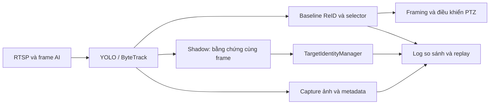

# Báo cáo tổng hợp nghiên cứu: bảo toàn danh tính mục tiêu trong hệ thống AI PTZ

**Ngày tổng hợp:** 19/11/2026.  
**Phạm vi:** Phase 0/1, ghi dữ liệu camera, các phiên đánh giá thực tế và chuỗi cải tiến shadow v1–v4.  
**Cập nhật sau phiên 19:13:52:** v4 đã chạy live hợp lệ, replay khớp 276/276 quyết định. [Audit live](../identity_shadow_audit_20261119_191352/REPORT.md). Đã đánh giá Phase 2 trên capture mới và thử 30 kịch bản lịch lấy mẫu trên ba capture; chưa đưa thay đổi Phase 2 vào live vì chưa đạt tiêu chí. [Báo cáo tiếp nối](../identity_phase2_v4_followup/REPORT.md).

**Cập nhật Phase 2B:** đã audit đủ 205 disagreement, tạo review pack 2.201 frame và PoC continuation offline, chạy A/B/C/E1/E2/E3 với 359 test đạt. Kết luận NO-GO cho tích hợp: chỉ thêm localization provisional có giới hạn, chưa có GT độc lập chứng minh accuracy tốt hơn. Source/config live giữ nguyên. [Báo cáo Phase 2B](../identity_phase2b/REPORT.md).

Các số liệu nghiên cứu bên dưới giữ theo mốc tổng hợp ban đầu; kết quả mới nhất nằm trong hai báo cáo liên kết ở trên. Chưa có ground truth độc lập để xác nhận cải thiện identity accuracy.

## 1. Kết luận hiện tại

Hướng đang nghiên cứu là **Identity-Preserving Hybrid PTZ Tracking**: duy trì đúng người mục tiêu qua thay đổi track ID, giao cắt, che khuất và mất dấu; chỉ cho phép quyết định bám khi bằng chứng về danh tính và vị trí đủ tin cậy.

Đã xây dựng được nền tảng thực nghiệm gồm ghi ảnh và nhãn target tự động, kiểm tra tính toàn vẹn dữ liệu, replay cùng bằng chứng, bộ quản lý identity độc lập và chế độ shadow trên camera thật. Đã tìm và xử lý các vấn đề cụ thể về tiếp tục bám sau HOLD ngắn, reset identity, bỏ dở công việc ReID và chi phí xử lý shadow.

**Kết quả đã chứng minh chủ yếu là tính đúng đắn của cơ chế, khả năng tái hiện và hiệu năng trong phạm vi thử nghiệm. Chưa chứng minh giảm bám nhầm người, ID switch hoặc thời gian phục hồi theo nhãn chuẩn độc lập.** Số lần chọn được target và mức đồng thuận với baseline không phải độ chính xác.

Trạng thái triển khai hiện tại:

- Baseline vẫn quyết định điều khiển PTZ trong ứng dụng thật.
- Phase 1 chạy offline hoặc shadow, chưa được trao quyền điều khiển camera.
- `IDENTITY_MEMORY_ENABLED=False`, `IDENTITY_MEMORY_GALLERY_ENABLED=False`.
- Shadow mặc định chưa chạy, phải Start trong GUI. Batch v4 hiện là mặc định khi chạy `python3 ptz/main.py`; `PTZ_SHADOW_BATCHED=0` chỉ dùng để đối chiếu/quay lui v3.
- Bộ kiểm thử hồi quy gần nhất của v4: **298 test pass**. Đây là tổng ở mốc mới nhất, không cộng với số test của các mốc cũ.

## 2. Bài toán và giả thuyết nghiên cứu

Pipeline hiện có gồm RTSP → YOLO → ByteTrack → OSNet/ReID → lựa chọn target và trạng thái framing → bộ điều khiển HANET PTZ. Ba loại định danh cần tách biệt:

| Khái niệm | Ý nghĩa |
|---|---|
| `target_uid` | Danh tính mục tiêu mà phiên làm việc muốn theo dõi |
| `track_id` | ID tracklet do MOT cấp; có thể đổi, mất hoặc bị tái sử dụng |
| `candidate_id` | Định danh ứng viên trong bằng chứng của một frame |

Baseline đã có `target_uid` độc lập; vấn đề không đơn thuần là thiếu UID. Hướng mới làm rõ bộ nhớ danh tính, nguồn gốc bằng chứng và điều kiện chấp nhận: cùng `track_id` không tự chứng minh vẫn là đúng người; đổi `track_id` không tự chứng minh đã đổi người.

Các giả thuyết đang được kiểm tra:

1. **Bộ nhớ identity có ràng buộc** giúp nối lại mục tiêu sau gián đoạn mà không làm nhiễm ảnh tham chiếu hoặc gallery.
2. **Kết hợp appearance, geometry, thời gian và đối thủ cạnh tranh** giúp phân biệt duy trì target với bắt nhầm người có ngoại hình tương tự.
3. **Độ liên tục của bằng chứng là một phần của chất lượng tracking.** Chính sách cần nhiều lần xác nhận sẽ hoạt động khác khi các mẫu đến đều so với khi mất khoảng dài do tranh chấp GPU.
4. Local tracking và bù chuyển động camera có thể hỗ trợ vị trí, nhưng phải đánh giá riêng; chúng không được tự xác nhận danh tính.

Mục tiêu cuối là tăng thời gian bám đúng, giảm thời gian bám sai, ID switch, fragmentation và thời gian phục hồi, đồng thời giữ độ trễ phù hợp cho PTZ. Các mục tiêu này vẫn cần đánh giá có nhãn chuẩn.

## 3. Những thành phần đã làm được

### 3.1. Hạ tầng dữ liệu và đánh giá

- Ghi các frame AI kèm candidate, bbox, track ID, target/session, timestamp và quyết định baseline; có checksum ảnh, cấu hình, source và model để đối chiếu.
- Tạo nhãn target tự động từ quyết định của hệ thống đang chạy. Khi hệ thống không xác định được target thì giữ trạng thái chưa biết, không tự tạo nhãn chắc chắn.
- Kiểm tra checksum, decode, kích thước, thứ tự frame/timestamp và trạng thái hoàn tất capture.
- Tạo cache bằng chứng OSNet và replay baseline/Phase 1 trên cùng dữ liệu; xuất reason, state, action và các điểm bất đồng để review.
- Có công cụ nhập/review nhãn và tính metric theo nhãn độc lập khi có dữ liệu phù hợp.

Nhãn tự động là **pseudo-label**: hữu ích để ghi lại hệ thống đã chọn ai, nhưng không thể dùng chính lựa chọn đó làm chuẩn để chứng minh hệ thống chọn đúng. Không cần gán lại toàn bộ dữ liệu chỉ để đo hiệu năng, kiểm tra replay hoặc so sánh cơ chế. Đánh giá đúng/sai identity cần một tập được kiểm chứng độc lập.

Thành phần chính: [recorder](../../runtime/identity_recording.py), [chuẩn bị capture](../../tools/prepare_identity_capture.py), [replay](../../tools/identity_replay.py), [metrics](../../tools/identity_metrics.py), [công cụ review nhãn](../../tools/label_identity_capture.py). Hướng dẫn: [record và nhãn tự động](../identity_record/README.md).

### 3.2. Bộ quản lý identity Phase 1

[TargetIdentityManager](../../ai/target_identity.py) bổ sung ảnh tham chiếu gốc bất biến, quan sát đáng tin gần nhất, lịch sử có giới hạn, kiểm tra nguồn gốc và tuổi bằng chứng, cùng các trạng thái:

`CONFIRMED_VISIBLE`, `VISIBLE_UNVERIFIED`, `AMBIGUOUS`, `OCCLUDED_PREDICTED`, `LOST_IN_FOV`, `OUT_OF_FOV`.

Các trạng thái về che khuất hoặc ra khỏi khung cần bằng chứng từ bên gọi; manager không tự biết chắc tình trạng vật lý chỉ từ việc mất detection. State identity cũng khác với state framing/pan/zoom của ứng dụng.

Các gate chính gồm similarity với reference, margin với ứng viên khác, geometry/time continuity, nhiều quan sát xác nhận, tuổi dữ liệu và target/session hợp lệ. Bằng chứng cũ, sai phiên hoặc không đầy đủ không được trở thành xác nhận mới. Gallery thích nghi vẫn tắt; lịch sử đối thủ chưa phải hệ thống quản lý identity distractor hoàn chỉnh của Phase 2.

### 3.3. Shadow trên camera thật

Shadow nhận frame và candidate tương ứng để tính quyết định Phase 1, rồi ghi so sánh với baseline. **Shadow không gửi lệnh motor**, nhưng vẫn dùng CPU/GPU nên có thể ảnh hưởng tài nguyên của luồng chính.



Không có đường từ shadow tới bộ điều khiển. `physical_commands=0` trong báo cáo shadow/offline chỉ áp dụng cho phần thử nghiệm đó; baseline vẫn có thể điều khiển camera trong phiên live.

Thành phần: [shadow worker](../../runtime/identity_shadow.py), [batch backend v4](../../runtime/identity_shadow_batch.py), [hướng dẫn shadow](../identity_shadow/README.md).

## 4. Diễn biến và kết quả thực nghiệm

Các phiên dưới đây khác cảnh và điều kiện vận hành. Chỉ những phép so sánh trên cùng evidence hoặc fixture được kiểm soát mới dùng để đánh giá trực tiếp một thay đổi.

| Mốc | Kết quả quan sát / công việc hoàn thành | Ý nghĩa và giới hạn |
|---|---|---|
| Phase 0/1 ban đầu | Xây dựng manager, cache, replay, metric; thử video có sẵn và 185 test | Có nền tảng đánh giá; replay ban đầu rất bảo thủ, chưa đạt điều kiện triển khai |
| Camera 08:17 | Hai capture 114 và 26 frame hợp lệ; phát hiện main frame cũ trong khi sub tiếp tục | Thêm gate không vẽ overlay lên main quá cũ; chưa chứng minh recorder gây lỗi HEVC |
| Camera 08:30 | Capture 1667 frame; sửa tiếp tục bám sau HOLD ngắn: Phase 1 chọn 1270 → 1443 frame trên cùng dữ liệu | Giảm HOLD do cơ chế chuyển ngưỡng; chưa chứng minh 173 lựa chọn thêm đều đúng |
| Camera 08:48 | 471 comparison shadow; phát hiện reset cùng target tạo lại trạng thái acquire | V2 giữ session/history và buộc reacquire đúng ngưỡng |
| Camera 09:03, shadow v2 | Capture 1502 frame dùng được, nhưng chỉ hoàn tất 4 comparison trong 168,81 giây | Bỏ dở giữa raw/normalized ReID làm shadow gần như không lấy được mẫu |
| Shadow v3 | Giữ kết quả từng lượt của cùng job; retry lượt còn thiếu, không gia hạn tuổi | Sửa lãng phí tính lại và bỏ dở; kiểm chứng offline trước khi chạy live |
| Camera 17:32, shadow v3 | Capture 1505 frame; 259 comparison trong 157,47 giây; GUI ổn định trong số đo | Shadow hoạt động thực tế, nhưng chuỗi mẫu còn thưa và không đều |
| Shadow v4 | Batch raw/normalized, preprocessing ngoài thời gian giữ accelerator; 298 test pass; kiểm chứng 5 capture | Tương đương quyết định trên dữ liệu đã thử; hiệu năng có triển vọng, đang chờ kiểm chứng live |

Nguồn: [Phase 0/1](../identity_phase01/REPORT.md), [08:17](../identity_capture_audit_20261119/REPORT.md), [HOLD](../identity_hold_analysis/REPORT.md), [08:48](../identity_shadow_audit_20261119_084852/REPORT.md), [v2](../identity_shadow_v2/REPORT.md), [09:03](../identity_shadow_audit_20261119_090305/REPORT.md), [v3](../identity_shadow_v3/REPORT.md), [17:32](../identity_shadow_audit_20261119_173204/REPORT.md), [v4](../identity_shadow_v4/REPORT.md).

### 4.1. Tiếp tục bám sau HOLD ngắn

Trên capture 1667 frame, Phase 1 cũ chuyển sang điều kiện reacquire mạnh sau một gián đoạn ngắn, gây HOLD kéo dài. Cơ chế bổ sung cho phép resume trong cửa sổ có giới hạn khi còn anchor đã được chấp nhận: cùng track đã biết, geometry và appearance continuity đạt yêu cầu, reference đạt ngưỡng keep và vẫn đủ xác nhận.

HOLD không làm mới anchor; mất target thực sự làm mất quyền resume; đổi ID vẫn cần điều kiện bắt lại mạnh. Trên cùng dữ liệu, số frame được chọn tăng **1270 → 1443**; hai đoạn HOLD được phân tích giảm khoảng **10,7 → 0,47 giây** và **2,6 → 0,30 giây**. Hai capture ngắn giữ nguyên kết quả. Đây là thời gian HOLD của chính sách, không phải recovery latency theo GT. [Kết quả chi tiết](../identity_hold_analysis/REPORT.md).

### 4.2. Reset và chuỗi phiên identity

V2 phân biệt đổi target/reference thật với reset baseline trên cùng target. Trường hợp thứ hai giữ identity session/history, xóa continuity đang chờ và dùng ngưỡng reacquire **0,70**, thay vì trở lại acquire **0,65**.

Replay 471 mẫu của phiên 08:48 tái hiện đúng quyết định cũ; áp dụng reset mới làm thay đổi 8 lựa chọn có score 0,663–0,699. Đây là sửa tính nhất quán của policy, không phải chứng minh đã sửa 8 lần nhận nhầm. [Bằng chứng v2](../identity_shadow_v2/REPORT.md).

### 4.3. Bản ghi mới nhất và nút thắt sampling

Phiên 17:32 có **1505 frame / 155,94 giây**, kiểm tra ảnh/metadata hợp lệ, recorder báo 0 drop và 0 error. Dữ liệu dùng được cho phân tích tiếp; không cần quay lại để cứu bản ghi này.

| Chỉ số shadow v3 live | Kết quả |
|---|---:|
| Comparison hoàn tất | 259 / 157,47 giây ≈ 1,64 mẫu/s |
| Job được nhận / hoàn tất / bị loại | 343 / 259 / 84 |
| Tuổi mẫu median / P95 / max | 382 / 704 / 787 ms |
| Khoảng mẫu median / P95 / max | 0,366 / 1,967 / 4,637 giây |
| Khoảng mẫu vượt 1 giây | 44 |
| Receive → GUI-submit median / P95 / max | 59,11 / 74,47 / 133,76 ms |

Giới hạn xác nhận là gap tối đa 1 giây; vì vậy nhiều mẫu hợp lệ về tuổi vẫn không tạo được chuỗi xác nhận liên tục. Trong 54 lần chờ xác nhận, có **19 lần chuỗi pending phải bắt đầu lại do gap >1 giây**; 13 lần trong số đó đồng thời không đạt IoU continuity. Không quy cả 19 trường hợp hoàn toàn cho sampling.

Replay đúng lịch mẫu/reset đã ghi tái hiện **255/255 comparison có ảnh**, khớp lựa chọn, reason, state và action. Thử replay dày hơn làm **79 thời điểm từ HOLD thành chọn được candidate** tại cùng các thời điểm đối chiếu. Đây là chẩn đoán offline với mốc reset đại diện, không phải kết quả mà camera live đã đạt được.

Replay chuẩn toàn bộ 1505 frame: baseline chọn 1116, Phase 1 chọn 1055; cùng chọn 1044, cùng HOLD 378, baseline-only 72, Phase 1-only 11, không có mẫu cả hai cùng chọn nhưng khác candidate. Những số này mô tả bất đồng chính sách, không xác nhận ai đúng. [Audit và replay](../identity_shadow_audit_20261119_173204/REPORT.md).

### 4.4. V4: giảm chi phí shadow, giữ nguyên quyết định

V4 chuẩn bị tensor trên CPU trước khi xin accelerator, ghép raw/normalized crops thành các minibatch và nhả tài nguyên giữa các minibatch. Kết quả đã hoàn tất chỉ được giữ cho đúng job/frame hiện tại. Không dùng embedding cũ làm bằng chứng frame mới, không hạ similarity, không nới deadline 0,8 giây hoặc max-gap 1 giây.

**Tính tương đương:** OSNet CUDA thật trên **4814 frame / 10180 candidate từ 5 capture**, không khác selected candidate, reason, state hoặc action. Sai khác số học tối đa khoảng 7,83×10⁻⁷ cho embedding và 3,28×10⁻⁷ cho score. Đây là dữ liệu đã được sử dụng trong phát triển, không phải tập holdout độc lập. [Kết quả máy đọc](../identity_shadow_v4/validation_result.json).

**Benchmark 60 frame giống nhau, đổi thứ tự chạy v3/v4 giữa các ảnh:**

| Chỉ số mỗi job | V3 | V4 |
|---|---:|---:|
| Wall time median | 34,27 ms | 22,58 ms |
| Wall time P95 | 49,85 ms | 53,45 ms |
| Tổng thời gian giữ accelerator median | 32,08 ms | 15,90 ms |
| Một lần giữ accelerator dài nhất, max | 37,16 ms | 70,91 ms |

Trung vị cải thiện, nhưng đuôi phân phối chưa cải thiện đồng đều. Đây là wall time và thời gian giữ scheduler ngoài cùng, không phải thời gian CUDA kernel thuần hoặc FPS live.

**Fixture tranh chấp có kiểm soát:** dùng cùng cửa sổ 12 giây từ log thật, OSNet shadow chạy thật, foreground được mô phỏng bằng thread giữ scheduler theo thời lượng log. Tổng ba lượt mỗi đường:

| Chỉ số | V3 | V4 |
|---|---:|---:|
| Comparison hoàn tất | 58 | 86 |
| Job stale/canceled | 23 | 12 |
| Khoảng mẫu >1 giây | 13 | 7 |
| Pass hoàn tất thuộc job bị hủy | 15 | 1 |

Số comparison tăng **48,3% trong fixture này**. V4 vẫn có gap tối đa 1,59–1,79 giây; P95 chờ foreground không tốt hơn trong mọi lượt. Chưa thể suy ra FPS camera tăng 48,3%, hết lag hoặc hết đứt confirmation. [Phương pháp và giới hạn](../identity_shadow_v4/REPORT.md), [kết quả contention](../identity_shadow_v4/contention_result.json).

## 5. Những hạn chế còn lại

| Vấn đề | Bằng chứng hiện có | Hướng xử lý |
|---|---|---|
| Mẫu shadow thưa, thiếu đều | V3 live có 44 gap >1 giây; v4 fixture vẫn còn gap dài | Kiểm chứng v4 live; tiếp tục đo admission, tuổi và khoảng mẫu |
| Phase 1 HOLD bảo thủ khi overlap | Capture 09:03 có 196/240 frame baseline-only do overlap; 92/196 nằm trong điều kiện minor-contact của baseline | Đánh giá overlap riêng trên cùng evidence, gồm giao cắt dễ nhầm; chưa nới gate từ một clip |
| Similarity thấp | Phiên 17:32 có nhiều HOLD vì reference similarity; replay còn đoạn HOLD dài 13,56 giây | Review tư thế, kích thước người, che khuất, ánh sáng và chất lượng reference |
| Chưa biết đúng/sai identity toàn clip | Có pseudo-label và review ảnh giới hạn, chưa có GT độc lập đầy đủ | Tạo tập kiểm chứng gồm mẫu đại diện và các tình huống khó; giữ riêng tập holdout |
| Main/sub và lỗi nguồn video | Đã thấy main cũ cùng lỗi decode HEVC; có gate overlay khi main quá tuổi | Gate giúp tránh overlay trên ảnh cũ, chưa sửa hay chứng minh nguyên nhân RTSP/codec |
| Chi phí shadow chưa đồng đều | V4 median tốt hơn nhưng wall P95/max hold có trường hợp xấu hơn | Đo phân phối độ trễ foreground và throughput trong camera thật |

Các giới hạn diễn giải cần giữ:

- Capture hiện tại là **ảnh AI được lấy mẫu**, không phải video main liên tục; recorder 0 drop không có nghĩa nguồn RTSP không mất frame.
- Receive → GUI-submit không đo độ trễ từ cảm biến tới màn hình và không chứng minh main/sub đồng bộ tuyệt đối.
- Trần shadow 5 Hz là giới hạn tốc độ nhận việc, không phải cam kết luôn đạt 5 mẫu/s.
- Cùng chọn một candidate không chứng minh cả hai đúng; cùng HOLD không chứng minh target thật sự vắng mặt.
- Không cộng số frame của các phép replay chồng lặp thành quy mô dữ liệu độc lập; không cộng số test qua từng phiên bản.
- Metric identity đang hướng tới bài toán một target được chỉ định; chưa phải bộ đánh giá đầy đủ MOTChallenge/MOTA/HOTA.

## 6. Vị trí trong lộ trình nghiên cứu

| Giai đoạn | Mục tiêu | Trạng thái tại báo cáo này |
|---|---|---|
| Phase 0 | Audit, record, replay, provenance và metric | Hạ tầng đã có; benchmark bằng GT còn thiếu |
| Phase 1 | Identity memory, trusted history, xác nhận và phục hồi | Đã triển khai, kiểm thử, replay và live shadow; chưa nghiệm thu chất lượng để điều khiển PTZ |
| Phase 2 | Distractor-aware matching, nhiều cue và giả thuyết khi mơ hồ | Chưa hoàn thành/kiểm chứng trong chuỗi nghiên cứu này; các gate hiện có là nền tảng |
| Phase 3 | Local tracking giữa các lượt YOLO, ưu tiên KLT offline | Chưa có kết quả nghiệm thu trong chuỗi này |
| Phase 4 | Bù chuyển động camera với kiểm tra tính hợp lệ | Chưa có kết quả nghiệm thu trong chuỗi này |
| Phase 5 | Đặc tính phản hồi PTZ và điều khiển dự báo | Chưa thực hiện thay đổi motor trong chuỗi này; bắt đầu bằng audit/dry-run |

Các module hoặc thử nghiệm lịch sử trong repository không tự được tính là các phase trên đã hoàn thành. Mỗi phase cần kết quả riêng trên baseline và dữ liệu có nguồn gốc rõ ràng.

## 7. Định hướng tiếp theo theo thứ tự ưu tiên

### Bước 1 — Kiểm chứng v4 dưới tải camera thật

Mục tiêu là kiểm tra liệu giảm công việc giữ accelerator có thực sự tạo chuỗi shadow đều hơn, trong khi hiển thị và inference chính vẫn đáp ứng tốt. Đây là phần còn thiếu ngay sau các kiểm chứng offline đã hoàn tất.

Đo: comparison/s, phân phối gap và số gap >1 giây, stale/cancel theo nguyên nhân, tuổi mẫu, tỷ lệ đứt pending confirmation, độ trễ/chờ foreground và receive → GUI. Kiểm tra `SHADOW_START.batched` để xác nhận phiên chạy đúng v4. So sánh với v3 trong điều kiện gần tương đương; một phiên OFF/ON/OFF giúp quan sát ảnh hưởng, nhưng chưa loại hết sai khác cảnh.

Giữ nguyên ngưỡng và quyền điều khiển trong bước này để tách ảnh hưởng scheduler khỏi thay đổi chính sách identity. Nếu v4 cải thiện không ổn định, tiếp tục tối ưu từ log trước khi cân nhắc bật mặc định.

### Bước 2 — Hoàn thiện đánh giá đúng/sai identity

Tiếp tục record và nhãn tự động theo target. Từ dữ liệu đó, lập tập review độc lập gồm cả đoạn chọn đúng dễ, HOLD, mất/bắt lại, giao cắt, người giống nhau và ra/vào khung. Review chỉ các điểm bất đồng sẽ làm lệch đánh giá; cần thêm mẫu đại diện hoặc ngẫu nhiên.

Gắn nhãn danh tính người thật, visibility và khoảng không xác định; để trống khi hình ảnh không đủ kết luận. Tách tập phát triển và tập kiểm chứng chưa dùng để chỉnh policy. Khi có nhãn, tính thời gian bám đúng/sai, ID switch, loss/fragmentation và recovery latency, đồng thời báo phạm vi được gán nhãn và episode chưa phục hồi.

Không cần người dùng gán thủ công toàn bộ capture trước khi tiếp tục công việc kỹ thuật. Tuy nhiên, muốn tuyên bố cải thiện độ chính xác thì phải có bằng chứng độc lập với đầu ra baseline.

### Bước 3 — Xử lý continuity và overlap của Phase 1

Sau khi xác định ảnh hưởng sampling, thử từng thay đổi riêng trên cùng cache: giữ chuỗi xác nhận hợp lệ, phân biệt tiếp xúc nhẹ với giao cắt mơ hồ, phân tích similarity thấp theo chất lượng ảnh. Mọi thay đổi phải được kiểm tra cả trường hợp dễ bắt lại lẫn trường hợp dễ chuyển nhầm người.

Chỉ xem xét dùng chung embedding baseline khi chứng minh đúng frame/candidate/session, còn tuổi và đủ ứng viên cạnh tranh. Không tái sử dụng embedding cũ như bằng chứng mới. Chưa bật gallery online hoặc giảm ngưỡng để làm tăng số frame được chọn.

Điều kiện chuyển sang đánh giá điều khiển là có dữ liệu đại diện và nhãn độc lập, chất lượng identity cải thiện trong phạm vi đã thống nhất, độ trễ được kiểm chứng, regression đạt và rollback rõ ràng. **Chưa có ngưỡng nghiệm thu định lượng mới được xác lập trong báo cáo này.**

### Bước 4 — Mở rộng các phase còn lại theo bằng chứng

- **Phase 2:** xây dựng distractor memory và matching nhiều cue; kiểm tra điều kiện khả thi trước xếp hạng, giữ nhiều giả thuyết có giới hạn khi mơ hồ. Không chọn trọng số tùy ý hoặc bỏ đối thủ cạnh tranh để tăng score margin.
- **Phase 3:** đánh giá KLT offline bằng forward/backward error, tỷ lệ feature sống và outlier. Cần video/frame đủ dày để đo theo dõi giữa các lần YOLO; capture AI lấy mẫu hiện tại không tự đáp ứng yêu cầu này. Local tracker chỉ hỗ trợ vị trí.
- **Phase 4:** kiểm tra camera pose thực nếu có; nếu không, thử background flow/affine/homography với residual và điều kiện vô hiệu hóa. ACK lệnh camera không phải số đo chuyển động vật lý.
- **Phase 5:** audit/dry-run trước; đo phản hồi speed/pulse/START/STOP trong phiên vận hành phù hợp rồi mới đánh giá controller dự báo. Không đổi đồng thời identity và motor để tránh không biết thay đổi nào gây kết quả.

## 8. Phân công bước gần nhất

### Phần kỹ thuật có thể tiếp tục xử lý

Kiểm tra log/capture của phiên v4 khi có; đối chiếu hash và cấu hình; thống kê sampling/latency; replay cùng evidence; chuẩn bị tập review các tình huống overlap, similarity thấp và crossing. Các phân tích dữ liệu đã có không đòi hỏi quay lại từ đầu.

### Phần cần người dùng vận hành camera

Thực hiện một phiên v4 có kiểm soát. Từ `/mnt/files/Project/ptz`, trong môi trường Python đang dùng:

```bash
PTZ_SHADOW_BATCHED=1 python3 ptz/main.py
```

1. Chọn target, chạy khoảng 20 giây khi shadow OFF.
2. Bật record trước, rồi Start Phase 1 shadow; chạy khoảng 60 giây, gồm đi lại, xoay người và che khuất/giao cắt nếu điều kiện cho phép.
3. Stop shadow trước, Stop record, giữ baseline chạy thêm khoảng 20 giây; chờ lưu xong rồi đóng ứng dụng.
4. Giữ log và capture; ghi lại thời điểm nếu thấy lag hoặc `saved` ngừng tăng. Không cần gán lại nhãn cho phép thử hiệu năng này.

Nếu shadow gây lag rõ, Stop shadow và giữ dữ liệu để phân tích. Để trở về đường v3, khởi động lại không có prefix trên hoặc dùng `PTZ_SHADOW_BATCHED=0`. Đây là phép thử shadow; quyền điều khiển vẫn thuộc baseline.

## 9. Khả năng tái lập và tài liệu nguồn

Git root: `/mnt/files/Project/ptz/ptz`. Nhánh làm việc: `work/identity-phase01-20261119`. SHA nền: `ede31989fe6a39b04d7cd4d31675ebd811a28397`.

Baseline thực nghiệm là **SHA cộng working tree đã lưu**, do workspace đã có thay đổi trước nghiên cứu. Các sửa đổi có sẵn ở `ai/hybrid_reid.py` và `ai/overlap_policy.py` không được tính thành thuật toán mới của Phase 1. Snapshot đầu ở [identity_phase01_baseline](../../../validation/identity_phase01_baseline/); các bước sau có snapshot và manifest riêng. Không dùng reset Git để thay thế rollback có kiểm tra checksum.

| Nhóm tài liệu | Liên kết |
|---|---|
| Audit kiến trúc và Phase 0/1 | [Báo cáo gốc](../identity_phase01/REPORT.md) |
| Record, auto-label và hiển thị | [Hướng dẫn record](../identity_record/README.md), [audit 08:17](../identity_capture_audit_20261119/REPORT.md) |
| Sửa HOLD ngắn | [Phân tích](../identity_hold_analysis/REPORT.md), [số liệu so sánh](../identity_hold_analysis/comparison_summary.json) |
| Reset và admission v2 | [Báo cáo v2](../identity_shadow_v2/REPORT.md) |
| Retry/resume v3 và overlap | [Báo cáo v3](../identity_shadow_v3/REPORT.md) |
| Dữ liệu live mới nhất | [Audit 17:32](../identity_shadow_audit_20261119_173204/REPORT.md), [replay đúng mẫu](../identity_shadow_audit_20261119_173204/sampled_replay_summary.json) |
| Batch v4 | [Báo cáo v4](../identity_shadow_v4/REPORT.md), [parity/benchmark](../identity_shadow_v4/validation_result.json), [contention](../identity_shadow_v4/contention_result.json) |
| Kiểm thử gần nhất | [298 regression tests](../identity_shadow_v4/regression.log), [30 shadow tests sau bổ sung hash](../identity_shadow_v4/final_shadow_tests.log) |

Báo cáo này tổng hợp bằng chứng đã có, không tạo thêm phiên thử camera, không chạy lại benchmark và không thay đổi runtime, policy hay cấu hình. Các hướng dẫn “chạy phiên tiếp theo” trong báo cáo cũ là trạng thái tại thời điểm viết; kế hoạch hiện tại là kiểm chứng **v4 live**, sau đó hoàn thiện đánh giá identity có nhãn độc lập.
