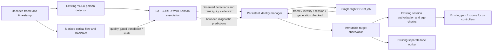

# Identity-aware tracking implementation — 16 November 2026

Implemented an **opt-in** identity-aware tracking path, offline evaluation, annotations, and diagnostics. The previous hybrid path remains the default. **Production improvement is not established**: synthetic continuity improved, but the available monitor recording produced less selected-target dwell with the new conservative gates. No physical camera commands were issued during this work.

## A. Root-cause findings

The [pre-change audit](audit.md) answers all ten audit questions and maps the existing pipeline. Source code, original November 16 application logs, profiler summaries, camera logs, and sampled video frames were inspected.

| Finding | Source/evidence | Interpretation |
|---|---|---|
| Configured runtime already uses periodic ReID, not an every-frame identity gate | `config.py:TARGET_CONTINUOUS_REID=False`; `ai/hybrid_reid.py:select_person/_take_verification` | The task needed an extension of the hybrid architecture, not replacement with an entirely new pipeline. |
| Geometric continuity compares current box to the previous uncompensated image box | `ai/hybrid_reid.py:select_person`, `jump` check against `REID_TRACK_IOU=.25` | Camera translation/zoom can trigger MOTION_DISCONTINUITY even when a moving-camera tracker could preserve association. This is a source-level failure mechanism; its exact share of November losses is not established. |
| Hybrid verification has finite evidence age and negative counters | `REID_IDENTITY_MAX_AGE=5`, `REID_NEGATIVE_CONFIRMATIONS=3`, KEEP=.50 | Unavailable or poor appearance evidence can force HOLD even with a continuous track. Initial .65 and recovery .70 are separate thresholds. |
| Full loss discards motion history | `ai/reid_target.py:reset/finish_frame`; `runtime/inference_worker.py:reset_tracking_worker` | Reference and persistent UID survive, but previous body geometry and native tracks were cleared. |
| Runtime GMC was diagnostic only | `runtime/byte_tracking.py:update`; `runtime/camera_motion.py`; offline-only `camera_motion_shadow.py` | No motion correction helped runtime association. |
| Gallery was only five reference-image photometric variants | `ai/reid/gallery.py:TargetEmbeddingGallery.build/score` | No trusted live views, provenance, eviction, or rollback existed. |
| Search/recovery OSNet blocked the detection owner | `hybrid_reid.py:select_person` calls `_scores` synchronously outside the stable path | Expensive scans can delay the next detector frame. GUI/control workers are already separate. |
| Late unrecovered loss is confirmed, its visual cause is not | `logs/ptz_20261116_083342.log:780` records SEARCHING at 08:38:05.480; subsequent samples include .512, .516, .510, .502; report ends loss at GUI shutdown after 77.559 s | Scores below .70 explain failure to confirm. They do not prove whether the visible person was the selected target. |
| FACE_ASSOCIATION_AMBIGUOUS covers several gates | `runtime/face_worker.py:_detect` | Head containment, exclusion by other bodies, previous-face geometry/margin, and multiple faces all share this label. It is not a count of ArcFace mistakes. |
| ZOOM_SESSION_MISMATCH includes STOP checks | `control/auto_zoom.py:_control_loop` | Control-only STOP preserves old correlation; repeated invalid-session checks increment counters. Stable verification does not rotate sessions, but HOLD revokes authority and recovery rotates it. This is not evidence of transport/motor failure. |

The selected reference changed at 08:34:14.628 to `person_search/targets/aded02f5-dc45-41cc-a9e8-61dabd31b3a9.jpeg`. The real replay uses that reference, rather than silently using the startup `target.jpg`.

The 235.603-second video is a **phone recording of the application monitor**. At video 120 seconds the displayed camera clock reads about 08:36:04; near video 234 seconds it still shows 08:37:5x. These sampled overlays do not provide synchronized sensor timestamps or the full final 08:38:05–08:39:23 failure. No claim is made that the final failure has been replayed.

## B. Architecture and behavior



**Tracking.** `IdentityPersonTracker` reuses installed Ultralytics 8.4.25 `BOTSORT`/`BOTrack`: XYWH Kalman prediction, high/low confidence association, track lifecycle, lost buffering, and reactivation. No extra encoder is loaded. OSNet assists **target identity association/rebinding**, while native multi-object association remains geometric. This is not a claim that every native track has a continuously refreshed appearance descriptor.

The adapter preserves original detector boxes/indexes. It exports timestamps/frame IDs, predicted box, velocity, age, observation gap, association IoU and competing-association margin, visibility/clipping quality, tracking status, and camera-motion context. Tentative/unmatched detections remain visible as provisional IDs to ambiguity gates; otherwise a new low-confidence foreground person could disappear from the identity manager's view. Provisional IDs cannot accumulate confirmations across frames.

**Camera movement.** Existing masked sparse optical flow, forward/backward consistency, RANSAC, inlier spread, residual, scale, blur, and gap checks are reused. Only sufficiently confident, near-axis-aligned translation/scale warps are applied, exactly once before association. The XYWH covariance Jacobian is propagated; unsupported rotation or low-quality GMC falls back to unwarped conservative association. PTZ busy state is logged as software context; `physical_motor_stopped` remains unknown. An ACK is never interpreted as physical stop telemetry.

**Identity.** `IdentityAwareTargetSelector` retains the established selector interface while owning persistent `target_identity_id` (existing target UID), temporary `track_id`, and independently rotating motor-session generation. Ordinary control resets retain the selected reference identity; replacing the reference creates a new identity. Three fresh positive result frames confirm initial acquisition or recovery; the .65 initial, .70 recovery, and .08 ambiguity thresholds remain unchanged. A distant new track during short recovery requires one extra confirmation, then becomes globally reachable under normal confirmation after the grace period. Global search is never permanently excluded by stale image coordinates.

Stable current observations may continue through appearance dips when association is reliable and unambiguous. The observation separately exposes `zoom_allowed`: TEMPORAL identity or a weak/clipped crop permits existing bounded pan/tilt follow but holds optical zoom at both the early submission and later policy paths until evidence recovers. Identity confidence is an **evidence tier**, VERIFIED or TEMPORAL, not a probability. Tracking confidence is association IoU, not a calibrated probability. Good-crop scores at/below .20 are hard contradictory evidence. Ambiguity, a missing/discontinuous track, insufficient visibility, or identity evidence older than 12 seconds revoke movement authorization. The 12-second horizon and other new defaults are uncalibrated policy parameters requiring annotated evaluation.

| Internal observation | Existing public behavior | Motor policy |
|---|---|---|
| OBSERVED / REACQUIRED | Existing TARGET_LOCKED/PERSON_ZOOM/VERIFIED progression | Permit current observed boxes with valid session/frame generation; hold zoom when `zoom_allowed=False` |
| UNCERTAIN | OCCLUDED_HOLD | Stop target-follow movement; require confirmation |
| OCCLUDED | OCCLUDED_HOLD, bounded hypothesis retained | Predictions are diagnostic hints only |
| LOST | SEARCHING with `reacquiring=True` | Existing bounded recovery zoom remains available; no automatic scan added |

Full loss retains the reference, trusted gallery, persistent UID, last reliable observation, and native lost-track buffer. Explicit target replacement, detector failure, watchdog/frame discontinuity, and ordinary resets retain the existing reset safeguards. Face absence or a failed recognition cannot invalidate a reliably observed person. Face recognition thresholds and assignment decisions are unchanged; only rejection detail logging was added.

**Async evidence.** A single occupied job slot bounds work, including across resets. Scoring snapshots persons, image, gallery, epoch, identity, session and generation. Capture time and frame ID travel with the result. Expired, superseded, reordered, or old-session evidence cannot bind the target. Results can verify identity only against a current observation; they never replace current coordinates. Acquisition and recovery now use the same background mechanism as verification. Detection/control do not wait for ReID completion.

**Gallery.** `TrustedTargetGallery` is copy-on-write, keeps all original reference variants, limits total entries to 12, rejects near duplicates, and records frame/time/identity/track/session/quality provenance. Admission requires a real observed, sufficiently visible, unambiguous, high-confidence crop with reliable temporal association and raw reference score at least .65. Predicted crops cannot enter. A live match can strengthen confirmation only when **two admitted live observations support it** and reference similarity remains at least .50; initial/recovery thresholds still apply. One high live match alone cannot authorize identity. Recent additions can be rolled back; strong contradictory evidence rolls back a configurable recent frame window. These rules reduce drift but do not prove it impossible.

**Diagnostics.** `IDENTITY_TRACKING_DECISION`, `IDENTITY_BOUND`, `IDENTITY_RESULT_DISCARDED`, `IDENTITY_GALLERY_ADMITTED`, `IDENTITY_METRICS_FINAL`, and `FACE_ASSOCIATION_REJECTION_DETAIL` use the existing JSONL profiler. Decisions include current and evidence-frame timestamps, IDs/generations, observed candidates, association/crop/GMC evidence, raw reference and final appearance scores, status transitions, software PTZ context, prediction hints, and aggregate counters. Normal mode emits transitions and periodic summaries; detailed mode emits each decision. ReID/association timing uses existing spans plus new measurements. Predictions are excluded from observed/authorized dwell. Tracker rebindings are explicitly not ground-truth identity switches. The log report also correlates dispatches with the last recorded uncertainty state; recovery zoom and incomplete rotations require interpretation.

## C. Exact source changes

Created:

- `runtime/identity_tracking.py`: `TargetObservation`, `EvidenceBoTSORT`, `IdentityPersonTracker`, `admitted_warp`.
- `ai/identity_manager.py`: `IdentityAwareTargetSelector`, async admission/consumption, confidence tiers, recovery, observations and metrics.
- `ai/reid/trusted_gallery.py`: `TrustedTargetGallery`, reference-anchored aggregation, admission, rollback.
- `tools/identity_replay.py`: YOLO/OSNet video caching, paired offline replay, synthetic scenario, annotation-aware metrics.
- `tools/annotate_identity_replay.py`: resumable desktop ROI annotation with persistent person labels.
- `tools/identity_report.py`: JSONL metric/stale-event/dispatch summary.
- `test/test_identity_tracking.py`: 33 focused CPU tests including worker integration and metric validity.

Modified:

- `config.py`: opt-in feature flag and policy parameters below.
- `gui/cctv_app.py`: selects the new identity manager when enabled.
- `runtime/inference_worker.py`: tracker choice, prediction/context handoff, explicit observation validity, preserved tracks on full loss, final metric emission.
- `ai/reid_target.py`: optional feature/provenance export to the new gallery path; legacy scoring behavior unchanged.
- `runtime/face_worker.py`: diagnostic subreasons under the existing ambiguity rejection.

A [source diff](implementation.patch) and [exact file/hash manifest](manifest.json) are provided for review. Generated replay frames/features occupy approximately 187 MB in `logs/identity_replay_nov16`; they are retained for annotation and repeatable evaluation.

No dependency, camera protocol, model-weight, recognition-threshold, person/face-ratio, autofocus, motor-owner, or STOP-policy changes were made. Existing source copies are saved under `.hotfix_checkpoints/identity_tracking_20261116/ptz/` at the workspace root; the source tree has no Git metadata.

| Configuration | Default / meaning |
|---|---|
| `IDENTITY_TRACKING_ENABLED` / `PTZ_IDENTITY_TRACKING` | OFF / `0`; opt-in new path |
| `IDENTITY_GMC_ENABLED` / `PTZ_IDENTITY_GMC` | ON within new path; `0` disables correction |
| `IDENTITY_GMC_MIN_QUALITY` | .35, fit quality heuristic |
| `IDENTITY_ASSOC_IOU` | .30, minimum temporal association IoU |
| `IDENTITY_MAX_OBSERVATION_GAP` | .45 s, maximum gap for reliable continuation |
| `IDENTITY_PREDICTION_MAX_AGE` | .75 s, diagnostic prediction horizon |
| `IDENTITY_TEMPORAL_MAX_AGE` | 12 s, bounded continuation since accepted identity evidence |
| `IDENTITY_VERIFY_STABLE_INTERVAL` | 1 s |
| `IDENTITY_VERIFY_UNCERTAIN_INTERVAL` | .25 s |
| `IDENTITY_SEARCH_INTERVAL` | .25 s |
| `IDENTITY_CONFIRM_MAX_GAP` | 2 s between confirmation result frames |
| `IDENTITY_CONTRADICTION_SCORE` | .20 on sufficiently visible crops |
| `IDENTITY_GALLERY_MAX_SIZE` | 12 including reference variants |
| `IDENTITY_GALLERY_DUPLICATE` | .98 cosine duplicate boundary |
| `IDENTITY_GALLERY_MIN_VISIBILITY` | .95; border-touching crops are conservatively downgraded |
| `IDENTITY_GALLERY_INTERVAL` | 1 s between live admissions |
| `IDENTITY_GALLERY_ROLLBACK_FRAMES` | 30 source-frame IDs |
| `IDENTITY_DISTANT_CONFIRM_EXTRA` | 1 extra short-term confirmation |
| `IDENTITY_DIAGNOSTICS` / `PTZ_IDENTITY_DIAGNOSTICS` | OFF / `0`; detailed per-frame decisions when `1` |
| `IDENTITY_DIAGNOSTIC_INTERVAL` | 1 s in normal verbosity |

## D. Validation and measurements

Environment: Conda `py`, Python 3.10.20, torch 2.7.1+cu118, OpenCV 4.13.0, Ultralytics 8.4.25, available CUDA. The person model metadata identifies `yolo26n.yaml`. Base-shell Python lacks torch. No new packages were installed.

- [Focused tests](unit.log): **33 passed**, CPU tensors/scripted scores and mocked controls; includes real BoT-SORT update and the GUI worker adapter.
- [Repository regression suite](regression.log): **621 discovered results, 619 passed, 2 environment errors**. `test_gstreamer_cpu` cannot import and `test_rtsp_unavailable_schedules_backoff_without_raising` errors because Conda `py` lacks `gi`. These failures arise in unchanged `camera/rtsp_player.py`. They are not treated as passed or silently skipped.
- [Final identity/face checks](final_scoped.log): **49 passed** after the last diagnostic change.
- Compilation of changed Python files succeeded.
- Actual YOLO + OSNet GPU inference cached **385 observations** from video 113–190 s at approximately 5 FPS using the reference selected in the original session.
- Actual CPU YOLO + OSNet inference also ran on a short video slice: [CPU smoke](cpu_smoke.json). This is availability validation, not CPU real-time acceptance.
- Existing zoom, focus, face, ownership, stale-session, transport-fault and shutdown mock-based regressions were included. No GUI display or live camera behavior was exercised.

| Synthetic labelled scenario, 100 frames | Previous hybrid | New identity path |
|---|---:|---:|
| Correct observed target seconds | 7.10 | 8.00 |
| Loss episodes | 2 | 1 |
| Recoveries | 2 | 1 |
| Recovery durations | 1.90, .70 s | 1.20 s |
| Annotated identity switches / false reacquisitions | 0 / 0 | 0 / 0 |
| ReID invocations | 32 | 32 |

[Machine-readable synthetic report](synthetic_replay.json). Scripted scores demonstrate the intended temporal-continuity policy, not OSNet accuracy. Slower initial/recovery confirmation is a visible tradeoff of distinct asynchronous result frames.

| November monitor recording, 113–190 s | Previous hybrid | New identity path |
|---|---:|---:|
| Selected observed target seconds, **unverified identity** | 16.81 | 10.21 |
| Loss episodes | 1 | 3 |
| Recoveries | 1 | 2 |
| Recovery durations | 59.45 s | 36.83, 26.22 s |
| Unresolved loss at end of replay slice | No | Yes |
| ReID invocations | 187 | 131 |
| Cached association/selection mean | 1.30 ms | 22.52 ms |
| Cached association/selection p95 | 2.49 ms | 27.74 ms |
| Correct identity time / ID switches / false reacquisition | Unknown | Unknown |

[Machine-readable recording report](nov16_replay.json), with separate decision JSONL paths. The new loss entries in this slice included person overlap and missing-track evidence. A lower dwell could reflect safer rejection or poorer continuity; **there are no labels to distinguish them**. This replay does not meet the production success criterion.

Both branches used the same cached detector/embedding observations. Offline replay completes each submitted ReID job before advancing to the next frame to make decisions reproducible. It does **not** reproduce GPU queue contention, original live detector cadence, transport delays, or physical PTZ response. The new path's measured extra CPU work includes optical flow/RANSAC and richer evidence. GPU cache inference averaged 14.72 ms detection and 22.45 ms all-candidate ReID, with p95 18.55/41.76 ms; these are cache measurements, not live pipeline FPS. CPU smoke averaged approximately 84.71 ms detection and 51.82 ms ReID over a tiny sample.

Scenario coverage: normal walking, rotation represented by low appearance scores, rapid/ambiguous movement, approaching scale changes, crossing and weak foreground detections, clipping, disappearance/return, field-of-view loss, compensated pan/zoom, below-initial-threshold continuation, near-equal similarities, old async results, and failed GMC. These are synthetic/unit safety checks; they are not fourteen independently annotated real-world validations.

## E. Remaining problems and risks

1. Correct-target continuity and non-increasing real identity errors are **not proven**. The monitor replay's lower selected dwell prevents recommending rollout on available evidence.
2. Raw decoded camera recordings, dense persistent-person annotations, and synchronized PTZ telemetry are missing for acceptance, especially the final 77.559-second loss. The phone recording adds glare, perspective, overlay boxes, and handheld motion.
3. A native tracker can switch identity despite good geometry; isolated similar-looking distractors remain a risk. The finite continuation horizon, contradiction gate, ambiguity checks and reference-anchored gallery reduce risk but require calibration. No per-person fresh OSNet descriptors are fused into every native association.
4. GMC remains vulnerable to parallax/local backgrounds and adds roughly 20 ms in this recording replay. Rotation and unreliable correction are intentionally rejected. Physical lens/motor response was not measured.
5. Live CPU/GPU contention, long-duration gallery drift, actual GUI interaction, and motor stability remain untested. The one-slot ReID worker bounds queue growth but cannot cancel an already executing model call; expired results are discarded.
6. GStreamer tests remain blocked by the missing Python `gi` binding in the runtime environment. No dependency repair or transport change was attempted.
7. Session mismatch volume remains observable but unchanged. It includes control-only STOP checks; optimizing it without a valid command-lifecycle measurement could weaken safety.
8. Annotation GUI requires a desktop; its CLI/compilation and evaluation schema were checked, but interactive labelling was not performed. `nov16_annotations.jsonl` is an **unannotated template**, not ground truth.

## F. Commands and next actions

Run from `/mnt/files/Project/ptz` using the existing Conda environment:

```bash
conda activate py

# New tracking path (starts the normal camera application).
PTZ_IDENTITY_TRACKING=1 python ptz/main.py

# Previous tracking path / immediate rollback.
PTZ_IDENTITY_TRACKING=0 python ptz/main.py

# New path with detailed JSONL decisions; existing profiling must be enabled.
PTZ_IDENTITY_TRACKING=1 PTZ_IDENTITY_DIAGNOSTICS=1 python ptz/main.py

# Optional isolated GMC comparison.
PTZ_IDENTITY_TRACKING=1 PTZ_IDENTITY_GMC=0 python ptz/main.py

# Focused CPU safety tests and full repository suite (no physical camera tests).
python -m unittest discover -s ptz/test -p test_identity_tracking.py -v
python ptz/tools/run_unit_tests.py

# Offline synthetic before/after evaluation.
python ptz/tools/identity_replay.py --synthetic --out /tmp/identity_synthetic.json

# Reuse the cached November interval without model inference or camera access.
python ptz/tools/identity_replay.py \
  --cache ptz/logs/identity_replay_nov16 \
  --out /tmp/identity_nov16.json

# Rebuild from video with the session's selected reference. Use --device cpu for CPU.
python ptz/tools/identity_replay.py \
  --video '16_11(1).mov' --cache /tmp/identity_nov16_cache \
  --reference ptz/person_search/targets/aded02f5-dc45-41cc-a9e8-61dabd31b3a9.jpeg \
  --device 0 --start 113 --end 190 --sample-fps 5 \
  --source-kind monitor_recording --out /tmp/identity_nov16_fresh.json

# Desktop annotation. Reuse persistent labels: target, person_b, person_c, ...
python ptz/tools/annotate_identity_replay.py \
  --cache ptz/logs/identity_replay_nov16 --out /tmp/identity_labels.jsonl

# Compare with those labels; unlabelled frames are not counted as correct identity.
python ptz/tools/identity_replay.py \
  --cache ptz/logs/identity_replay_nov16 \
  --annotations /tmp/identity_labels.jsonl --out /tmp/identity_annotated.json

# Inspect one live run's metrics, including all retained rotations.
python ptz/tools/identity_report.py \
  ptz/logs/latency/latency_trace_RUN_TIMESTAMP.jsonl* \
  --out /tmp/identity_metrics.json
```

Replace `RUN_TIMESTAMP` in the log command with the chosen run filename timestamp (for example, `20261116_083348_369309` for the existing legacy run). New identity metrics appear only in runs with the opt-in path enabled.

For manual annotations without OpenCV windows, each line is:

```json
{"frame_id": 3387, "target_identity": "target", "people": [{"identity": "target", "bbox": [100, 50, 170, 250]}, {"identity": "person_b", "bbox": [300, 60, 370, 260]}]}
```

Use actual cached frame IDs and coordinates. `people: null` means unannotated; `people: []` explicitly means no visible people. Dense labels and stable IDs are needed for trustworthy switch/recovery metrics. The evaluation never derives ground truth from tracker IDs or recognition MATCH labels.

Next: capture raw decoded frames and synchronized command metadata, label the same intervals for both branches, and assess correct-target seconds and wrong assignments before enabling the new path by default. Only then perform supervised physical-camera testing of movement, zoom/focus, and STOP/session behavior.
