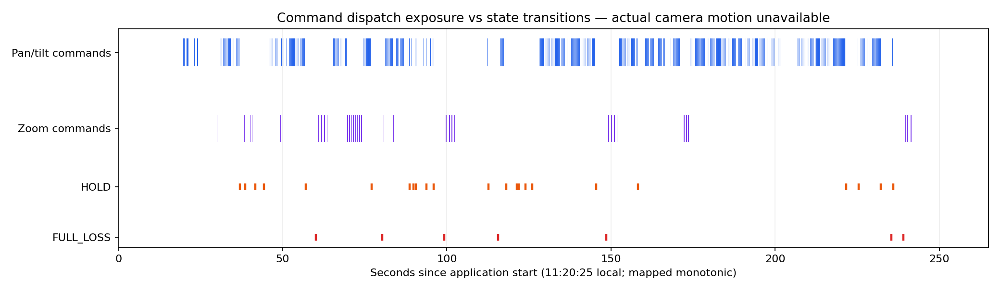

# AI PTZ — Camera motion: phân tích và tích hợp an toàn, 13/11/2026

**Kết luận: cần bổ sung dữ liệu RTSP/ground truth; giữ GMC và motion-aware control OFF.** Đã triển khai diagnostics tùy chọn, bộ thu frame có giới hạn, timeline, replay ByteTrack hai nhánh và kiểm thử offline. Chưa có đủ bằng chứng để bật bù chuyển động trong production hoặc kết luận camera motion là nguyên nhân chính của các lần mất khóa.

Phạm vi điều tra là phiên **11:20:25–11:24:50, UTC+7** theo yêu cầu. Không khởi động ứng dụng, không kết nối camera và không phát lệnh motor thật. Không thay controller, model, selector, gallery, overlap gate hay tham số điều khiển. Các phần đã triển khai và phần còn thiếu được tách rõ dưới đây.

## A. Evidence-based Root Cause

Nguồn: [báo cáo 11:20](ai_ptz_current_status_20261113_112025.md), [10:47](ai_ptz_current_status_20261113_104720.md), [10:20](ai_ptz_current_status_20261113_102026.md), application log, camera log cùng hai rotation, latency traces cùng ba rotation và [13_11.mov](../../13_11.mov). Hash các log dùng cho timeline nằm trong [timeline.json](ptz_camera_motion_20261113/timeline.json).

Camera log có 19.241 events, đầy đủ đầu/cuối phiên. Latency trace còn 43.112 dòng, **chỉ từ 11:23:51.918 đến 11:24:50.216903**. Vì vậy không thể dựng lại detections/ReID/frame association chi tiết của năm lần full loss đầu. MOV dài 139,92 s, 1920×1080, khoảng 29,97 FPS; thực chất là video quay màn hình, chứa phối cảnh, chuyển động thiết bị quay, GUI, OSD và bbox đã render.

Đối chiếu vẫn xác nhận 375 auto pan/tilt dispatch; 414 START + 415 STOP đều có ACK theo profile hiện tại; 23 HOLD, 7 full loss và 6 recovery. ACK xác nhận đường giao tiếp phần mềm, không đo motor bắt đầu/dừng vật lý.

### Các lần full loss

“Confirmed” bên dưới chỉ dùng cho cơ chế được ghi trong log. Nguyên nhân thị giác vẫn có thể là UNKNOWN/PROBABLE.

| Full loss | HOLD bắt đầu | HOLD → loss | Exposure khi bắt đầu HOLD | Recovery sau loss | Cơ chế confirmed / nguyên nhân |
|---|---|---:|---|---:|---|
| 11:21:25.174 | 11:21:22.091 | 3,083 s | Command active | 5,281 s | HOLD timeout; **UNKNOWN** nguyên nhân thị giác |
| 11:21:45.336 | 11:21:42.178 | 3,158 s | Command active | 0,658 s | HOLD timeout; **UNKNOWN** |
| **11:22:04.258** | 11:22:01.113 | 3,145 s | Command active | **13,221 s**, đến 11:22:17.479 | HOLD timeout; **UNKNOWN**; thiếu raw frames và trace chi tiết |
| 11:22:20.750 | 11:22:17.733 | 3,017 s | 0–300 ms sau STOP | 0,644 s | HOLD timeout; **UNKNOWN** |
| 11:22:53.575 | 11:22:50.548 | 3,027 s | 0–300 ms sau STOP | 4,016 s | HOLD timeout; **UNKNOWN** |
| 11:24:20.427 | 11:24:17.207 | 3,220 s | Command active | 0,396 s | PERSON_OVERLAP gate → UNCERTAIN → timeout confirmed; **TRUE_PERSON_OVERLAP / REID_IDENTITY_AMBIGUITY probable** |
| **11:24:24.145** | 11:24:21.089 | 3,056 s | 0–300 ms sau STOP | Chưa phục hồi trước khi kết thúc | Cùng cơ chế gate confirmed; **TRUE_PERSON_OVERLAP / REID_IDENTITY_AMBIGUITY probable**; có rủi ro đổi người chưa xác minh |

Chi tiết máy đọc: [root_cause_review.json](ptz_camera_motion_20261113/root_cause_review.json). Recovery là thời gian transition SEARCHING → TARGET_LOCKED, không trộn với latency đo theo trial khác trong telemetry. Lần cuối bị kiểm duyệt bởi thời điểm kết thúc phiên, không tính thành recovery thành công.

### Đoạn cuối: điều gì đã và chưa được chứng minh

- **11:24:10.455:** track 125 và 126 có IoU 0,674, box nhỏ nằm trọn trong box lớn. Đây là bằng chứng overlap hình học; chưa đủ phân biệt duplicate detection với hai người thực sự.
- **11:24:17.207:** track 125 với 127 có overlap/min-area 0,2075, vượt gate 0,15 hiện có; similarity 0,7745, margin 0,3382. Log chuyển identity từ VERIFIED sang UNCERTAIN. Gate kích hoạt ngay cả khi điểm appearance còn tương đối cao.
- **11:24:21.089:** log ghi target 128 ở box phía trên, overlap với 129 ở box phía dưới; ratio 0,2212, similarity 0,7210, margin 0,2517. Pan decision ngay trước đó còn gắn 129. Không được dùng sự thay đổi ID/box này làm bằng chứng xác nhận đổi danh tính, nhưng cần ưu tiên kiểm tra khi có GT.
- **11:24:23.754:** overlap ratio còn khoảng 0,4596, identity UNCERTAIN; full loss xảy ra lúc 24.145. Không có bằng chứng motor fault tương ứng.

Đã tạo [sáu keyframe có chú thích thủ công](ptz_camera_motion_20261113/monitor_annotations.json), từ MOV 118–138 s, OSD đọc được 11:24:17–11:24:37. Nhãn mô tả “áo đen/quần sáng” và “áo đỏ ngồi” được gán bằng quan sát hình ảnh, **không lấy ID hệ thống làm GT**. Box là vùng cơ thể nhìn thấy xấp xỉ trong tọa độ video quay màn hình; chưa có người thứ hai duyệt, chưa gán intended target và chưa annotate mọi người. Đây là tham chiếu thị giác tối thiểu, chưa phải GT dùng chấm raw replay.

Ở MOV 125 s/OSD 11:24:24, người áo đen vẫn hiện rõ. Đến MOV 138 s/OSD 11:24:37, người này không còn trong vùng camera hiển thị, người áo đỏ vẫn còn. Vì clock chưa đồng bộ, không suy ra thời điểm ra FOV chính xác hoặc coi out-of-FOV là nguyên nhân khởi phát loss lúc 24.145. Đoạn loss 11:22:04–17 có vẻ nằm trước MOV theo OSD, không thể tái hiện bằng clip này.

| Nhãn nguyên nhân yêu cầu | Mức bằng chứng hiện có |
|---|---|
| CAMERA_MOTION_ASSOCIATION_FAILURE | Chưa xác minh trên phiên thật; có cơ chế khả dĩ và tái hiện tổng hợp |
| TRUE_PERSON_OVERLAP | Probable ở đoạn cuối; confirmed chỉ ở mức overlap gate/detections |
| DUPLICATE_DETECTION | Nghi vấn tại 11:24:10; chưa có raw image/GT để xác nhận |
| DETECTION_MISSING | Không đủ dữ liệu để quy nguyên nhân các loss đầu |
| REID_IDENTITY_AMBIGUITY | Trạng thái UNCERTAIN confirmed; ambiguity danh tính vật lý chưa được GT xác minh |
| TARGET_OUT_OF_FOV | Người áo đen không còn thấy ở keyframe cuối; không chứng minh nguyên nhân onset loss |
| ZOOM_SCALE_CHANGE | Có command zoom; thiếu phép đo scale trên raw frames của phiên |
| STALE_FRAME_OR_RESULT | Không đủ bằng chứng quy loss cụ thể; giữ nguyên stale/session guards |
| UNKNOWN | Nguyên nhân thị giác chính của năm full loss đầu |

## B. Camera Motion Timeline



Trục nội bộ dùng monotonic. Mapping application wall time sang monotonic lấy median của các cặp timestamp camera log. Độ trải offset giữa các cặp là **2,907 ms**; application timestamp có độ phân giải 1 ms. Con số này không bao gồm độ trễ cảm biến, encode, mạng, decoder hoặc GUI.

| Nguồn thời gian | Ý nghĩa và giới hạn |
|---|---|
| Sensor capture timestamp | Không có clock cảm biến đồng bộ; giữ null |
| PTS | Không có chuỗi PTS đã được xác minh/gắn với frame ID trong dữ liệu hiện tại |
| FRAME_RECEIVED / receive_timestamp | Frame đã decode đi vào ứng dụng; không phải sensor exposure |
| Inference queue / detector spans / PERSON_DETECTION_RESULT | Cho biết chờ và xử lý sau arrival trong phần trace còn giữ; frame có thể được refresh trước inference |
| ByteTrack/selector/ReID events | Phải join frame ID + session/generation; không ghép chỉ bằng timestamp gần nhất |
| START_SENT → STOP_SENT | Khoảng lệnh kỳ vọng; ACK và STOP_SENT đều không chứng minh thời điểm motor đứng yên |
| MOV/OSD/GUI | Video position + OSD đọc được; offset và render delay chưa hiệu chỉnh, không dùng làm capture clock |
| Observed global motion phiên cũ | Không có raw frame pairs; để null |

Ví dụ frame 6848 của overlap lúc 11:24:17.207 có arrival monotonic 8334,2039545 và event 8334,2399227: chênh khoảng **35,97 ms**. Frame 6964 của overlap lúc 21.089 chênh khoảng **51,38 ms**. Đây chỉ là arrival → event. Công cụ audit lưu tuổi của pan decision gần nhất; bản ghi đó không mặc nhiên là frame gây HOLD. Nearby events ±800 ms chỉ là ngữ cảnh, không coi event tương lai là nguyên nhân.

### Exposure, không phải đo motor vật lý

Cửa sổ 264,995 s từ application start đến GUI shutdown request, bao gồm startup/searching. Chia hợp các khoảng START_SENT/STOP_SENT theo mọi code, không đếm đôi xung chồng nhau. Các bucket loại trừ nhau; command active ưu tiên hơn cửa sổ sau STOP. Không còn START chưa ghép STOP ở cuối camera log.

| Bucket | Exposure (s) | HOLD | HOLD/s | FULL_LOSS | FULL_LOSS/s |
|---|---:|---:|---:|---:|---:|
| Command active | 56,014 | 5 | 0,0893 | 0 | 0 |
| 0–300 ms sau STOP | 87,127 | 12 | 0,1377 | 0 | 0 |
| 300–800 ms sau STOP | 17,541 | 0 | 0 | 0 | 0 |
| Không command gần trong >800 ms | 104,313 | 6 | 0,0575 | 7 | 0,0671 |

**17/23 HOLD** ở command active hoặc ≤300 ms sau STOP. Exposure hai bucket này chiếm khoảng 54% cửa sổ. Đây là tương quan thô: command phụ thuộc target lock, tần suất pulse cao, các event phụ thuộc nhau, và denominator chứa cả thời gian chưa có target. Chưa phải hazard rate đã điều chỉnh theo thời gian target có nguy cơ mất.

Cả bảy full loss đều ở bucket không command gần vì xảy ra **3,017–3,220 s sau HOLD**; cả bảy HOLD khởi phát tương ứng lại ở active/≤300 ms. Vì vậy không thể kết luận “camera đứng yên mới mất target” từ bucket của FULL_LOSS.

Rate theo **observed moving/stationary**, track fragmentation theo danh tính thật và tương quan có hiệu chỉnh capture latency: **chưa đo được**. Không đặt tên command_quiet thành physical_stationary. Dữ liệu chi tiết: [timeline.json](ptz_camera_motion_20261113/timeline.json), [loss_events.csv](ptz_camera_motion_20261113/loss_events.csv).

## C. Motion Estimator

Triển khai mới trong [runtime/camera_motion.py](../runtime/camera_motion.py), không tự thay association. Input là hai decoded frames được ByteTrack xử lý liên tiếp, arrival timestamps, frame IDs/session và person bboxes. “Liên tiếp” ở đây là liên tiếp trong luồng xử lý; mailbox có thể bỏ frame RTSP giữa chúng.

Quy trình: grayscale → downscale ít nhất theo cấu hình 2, giới hạn chiều rộng khoảng 640 → mask người ở cả hai frame, mask OSD cấu hình và viền → tối đa 400 Shi–Tomasi points → sparse LK xuôi/ngược → partial affine RANSAC. Chuyển transform về pixel ảnh gốc, chiều **previous → current**. Không dùng full homography.

Output có dx/dy, 2×3 matrix, matches, inliers/ratio, median reprojection error, confidence heuristic, valid/reason, scale/rotation, classification và latency. Confidence không phải xác suất đã hiệu chuẩn. Phân loại LOW_IMAGE_MOTION/TRANSLATION/ROTATION/SCALE_CHANGE mô tả ảnh; không chứng minh chuyển động vật lý camera.

Reject khi gap ≤0 hoặc >0,5 s, timestamps không finite, shape sai, texture/blur kém, <16 matches, <12 inliers, ratio <0,55, support tập trung, residual >2,5 pixel gốc hoặc geometry bất hợp lý. Mask OSD rỗng mặc định ngoài viền; trước thu dữ liệu cần cấu hình vùng OSD nằm trong ảnh camera. Không phải mọi text overlay đều nằm ở viền.

Observer reset khi session/generation đổi, frame ID không tiến hoặc tracker reset. Lỗi diagnostics được bắt để tiếp tục association. Flag OFF không tạo observer, không copy frame, không chạy optical flow. Flag ON chạy estimator trên CPU trong worker; chưa được phép coi overhead là miễn phí.

### Tham khảo kỹ thuật và lựa chọn

| Nguồn | Điểm áp dụng trong nghiên cứu |
|---|---|
| [BoT-SORT paper](https://arxiv.org/abs/2206.14651) | Kết hợp motion, appearance và camera-motion compensation; không suy ra thay tracker sẽ tự cải thiện dữ liệu này |
| [Ultralytics GMC](https://docs.ultralytics.com/reference/trackers/utils/gmc/) | Đối chiếu downscale, sparse flow/feature methods và affine estimate; lựa chọn LK + RANSAC CPU cho bản thử nghiệm |
| [Ultralytics BoT-SORT](https://docs.ultralytics.com/reference/trackers/bot_sort/) | BOTrack dùng Kalman XYWH; phải kiểm tra state thực tế trước warp |
| [Frigate autotrack.py](https://github.com/blakeblackshear/frigate/blob/dev/frigate/ptz/autotrack.py) | Tham khảo mask detections, reset estimator và phân biệt frame time với khoảng PTZ; không mang logic ONVIF vào HANET |
| [Norfair camera motion](https://tryolabs.github.io/norfair/dev/reference/camera_motion/) | Phân biệt hệ tọa độ frame hiện tại và hệ tham chiếu; không trộn absolute transform với incremental transform |

Đã đọc implementation local Ultralytics **8.4.25**: STrack/ByteTrack hiện dùng **XYAH**, khác BOTrack XYWH. Generic rotation bằng kron trên state XYAH sẽ trộn aspect/height sai ý nghĩa. Do đó nhánh experimental chỉ nhận affine gần translation (ma trận 2×2 gần I, tolerance 0,01), confidence ≥0,35 và finite; zoom/rotation lớn fallback.

Sau native Kalman prediction, trước association high/low-score và unconfirmed: cộng translation vào mean x/y **một lần**, giữ a/h/velocity; Jacobian translation là I, covariance giữ nguyên ngoài thêm noise vị trí có chặn từ residual, tối đa 4 px². Test kiểm tra số lần warp và covariance PSD. Không truyền ảnh vào native GMC để tránh warp lần hai. Output vẫn lấy box detection gốc, không chỉ dịch bbox hiển thị.

Không thêm dependency hay copy nguyên tracker bên ngoài. Dùng OpenCV/NumPy/Ultralytics đã cài. Metadata package local: Ultralytics AGPL-3.0, OpenCV Apache 2.0; NumPy có license và thành phần bundled ghi trong [environment.json](ptz_camera_motion_20261113/environment.json). Không import Norfair/Frigate vào runtime.

## D. Baseline vs GMC

Tool: [camera_motion_replay.py](../tools/camera_motion_replay.py). Hai nhánh dùng cùng frames, cùng detections/confidence, cùng config và máy. Chạy tuần tự để không ảnh hưởng bộ đếm ID global của Ultralytics. GT tổng hợp chỉ được dùng để chấm sau hai lượt chạy; không đi vào tracker. Estimator chỉ xem previous/current frame, không future frame.

**Chưa chạy A/B raw RTSP phiên thật.** MOV không được chấp nhận làm raw replay bundle. Nhánh thử nghiệm chưa chạy Hybrid Selector/OSNet/face hoặc closed-loop PTZ; không thể chấm false HOLD, full loss, target dwell hay wrong-target follow từ kết quả này.

Stress test có 16 frames/case, 1024×360, dt=100 ms, texture tổng hợp seed cố định, một người rộng 24 px; dịch nền 25 px/frame trong hai case chuyển động. Cached detections hoàn hảo làm bài này dễ hơn detector thật.

| Case | Baseline missing-visible /16 | GMC missing-visible /16 | ID switches A/B | Fragmentations A/B |
|---|---:|---:|---:|---:|
| Camera tĩnh, người đi | 0 | 0 | 0 / 0 | 0 / 0 |
| Nền dịch, người đứng trong cảnh | 15 | 0 | 0 / 0 | 0 / 0 |
| Nền dịch và người đi | 15 | 0 | 0 / 0 | 0 / 0 |

**Không tuyên bố fragmentation giảm:** baseline không re-establish track nên metric fragmentation/IDSW vẫn bằng 0 dù thiếu 15 quan sát. Missing-visible mới phản ánh lỗi ở bài này. Chấm spatial greedy IoU ≥0,5, không phải full MOTChallenge evaluator. Kết quả chỉ chứng minh hook association có tác dụng với translation đã biết.

Mỗi case 15/15 pair valid; mean inlier ratio 1,0 trên texture tổng hợp. Mean |dx error| xấp xỉ 0,032 / 0,013 / 0,037 px; mean residual 0,011 / 0,021 / 0,025 px. Đây không phải motion-detection accuracy trên camera thật. [Kết quả đầy đủ](ptz_camera_motion_20261113/synthetic_ab.json), [tóm tắt](ptz_camera_motion_20261113/synthetic_summary.json).

| Điều kiện bật GMC | Đánh giá |
|---|---|
| Không tăng wrong-target following có GT | **Chưa đo** |
| Giảm fragmentation/false loss trên cảnh camera motion thật | **Chưa đo**; có cải thiện missing-visible tổng hợp |
| Không giảm tracking camera tĩnh | PASS cảnh tổng hợp nhỏ; chưa đủ cảnh thật |
| Fallback khi estimate kém | PASS unit/offline |
| Không giảm throughput đáng kể | **Chưa đo** trên pipeline thực |
| Không ảnh hưởng HANET/STOP safety | Regression PASS và protected-source hashes không đổi; chưa thử live |

## E. Tracking Safety và frame metadata

Production chỉ có hook quan sát opt-in trong ByteTrack adapter; không dùng motion metadata để chọn target, cập nhật gallery hay phát pulse. GMC_ENABLED và AWARE_CONTROL_ENABLED là cấu hình dành cho giai đoạn sau, chưa có đường runtime áp dụng hành vi. Bật hai giá trị này riêng lẻ cũng không bật shadow tracker.

Metadata sidecar gồm frame_id, previous_frame_id, arrival time, capture_timestamp, session, observed_global_motion và confidence. Capture timestamp hiện null. PTZ-command/expected-moving/zoom/settling mặc định null nếu chưa có nguồn command đã join; null không có nghĩa camera đứng yên.

[camera_motion_metadata.py](../tools/camera_motion_metadata.py) ghép offline frame arrival với command log cùng clock. Nó kiểm tra wall-minus-monotonic và coverage trước ghép, giữ unknown nếu không khớp. Expected-moving dùng active hoặc 0–300 ms sau STOP; settling dùng các bucket 0,3/0,8 s, là giả định phân tích chứ không thay policy controller. Unmatched START không tự coi là stopped. Hiện chưa có capture bundle thực để chạy join này trên hardware; test dùng dữ liệu tổng hợp.

Các thử nghiệm độc lập trong [camera_motion_shadow.py](../runtime/camera_motion_shadow.py): từ chối stale observation cho PTZ, gate gallery theo chất lượng, reject invalid GMC, chặn prediction quá tuổi và sai session. Đây chỉ là hàm tính quyết định offline; chưa tích hợp vào control/gallery.

Không ngừng YOLO/ByteTrack khi camera quay, không bỏ ReID verification, không kéo dài khóa vô điều kiện. Người khác overlap hoặc identity ambiguous vẫn đi qua gates hiện có. Khi target ra FOV, shadow không tự tạo output từ prediction để ép bám tiếp. Không dùng native track ID như bằng chứng danh tính.

Giới hạn còn lại: parallax/FOV rộng, rolling shutter, fast sweep, blur và foreground chiếm đa số có thể làm estimate sai dù residual thấp. Translation-only chưa giải quyết zoom. Các ca overlap/crossing tổng hợp chỉ kiểm tra đường xử lý/fallback, chưa chứng minh bám đúng người trong cảnh thật.

## F. Performance

Máy chạy offline: AMD Ryzen 5 4600H, Linux x86_64, Python 3.10.20, OpenCV 4.13.0.92, NumPy 2.2.6, Ultralytics 8.4.25. Replay đặt OpenCV một thread; không chạy YOLO/OSNet/ArcFace inference.

| Case | Estimator mean / P95 | Tracker baseline mean / P95 | Tracker GMC mean / P95 |
|---|---:|---:|---:|
| Tĩnh | 11,266 / 13,038 ms | 0,405 / 0,522 ms | 0,366 / 0,427 ms |
| Nền dịch | 18,771 / 22,313 ms | 0,355 / 0,389 ms | 0,509 / 1,103 ms |
| Nền dịch + người đi | 17,382 / 18,717 ms | 0,347 / 0,377 ms | 0,559 / 0,876 ms |

Mỗi case chỉ 15 estimates/16 tracker updates, chưa warm-up dài, không phải capacity benchmark. Tracker GMC timing không gồm estimator tính trước; cộng thêm estimator để hiểu chi phí. Timing estimator chưa tính recorder PNG, frame copy, telemetry và toàn bộ scheduler contention. Không lấy khác biệt vài phần mười ms làm kết luận tăng tốc.

Baseline **lịch sử** từ phiên 11:20: detection 10,52 FPS, YOLO mean/P95 32,50/54,08 ms, ReID 115,61/232,52 ms; receive→GUI 56,45/73,63 ms. Không có phiên chạy mới với diagnostics ON để đối chứng. CPU/GPU utilization, queue waiting, end-to-end throughput, center error, thời gian ngoài safe region và số command A/B: **NOT MEASURED**. Không phát sinh GPU inference trong test mới; điều đó không thay thế benchmark pipeline trên hardware.

## G. Changes và bảo toàn baseline

Workspace gốc không có Git metadata; đã tạo Git checkpoint riêng trước chỉnh sửa, lưu 188 file source/config/test cùng SHA-256. Không reset hay xóa thay đổi sẵn có.

| File | Thay đổi |
|---|---|
| [config.py](../config.py) | Thêm flags mặc định OFF, cấu hình estimator/recorder; không đổi thresholds cũ |
| [runtime/byte_tracking.py](../runtime/byte_tracking.py) | Hook diagnostics tùy chọn và reset observer; association cũ giữ nguyên |
| [runtime/camera_motion.py](../runtime/camera_motion.py) | Estimator và observation metadata |
| [runtime/motion_recording.py](../runtime/motion_recording.py) | Recorder PNG + detection metadata, queue bounded |
| [runtime/camera_motion_shadow.py](../runtime/camera_motion_shadow.py) | Translation warp và safe-handling thử nghiệm, chỉ offline |
| [tools/camera_motion_audit.py](../tools/camera_motion_audit.py) | Timeline và rates command exposure |
| [tools/camera_motion_replay.py](../tools/camera_motion_replay.py) | Cached-detection A/B, synthetic và decoded-frame bundle |
| [tools/camera_motion_metadata.py](../tools/camera_motion_metadata.py) | Join command/frame offline, không sửa bundle gốc |
| [test/test_camera_motion.py](../test/test_camera_motion.py) | 28 unit/offline/integration tests mới |

Chỉ **2/188 file cũ thay đổi: config.py và runtime/byte_tracking.py**. Hash 186 file cũ khác khớp, bao gồm detector, selector, ReID, face, HANET và controller. Hash camera.json và cả 6 model khớp. 153 effective config values cũ khớp; source hash config.py khác vì có flags mới, không tuyên bố cả file config bất biến.

Replay trước/sau: **127 observations qua ByteTrack + selector thật, 7 state transitions giống hệt**, cùng selected bbox/track state/score-call count. Appearance scores trong fixture được mock, không phải model accuracy benchmark. Bằng chứng: [scope_verification.json](ptz_camera_motion_20261113/scope_verification.json), [before](ptz_camera_motion_20261113/tracking_before.json), [after](ptz_camera_motion_20261113/tracking_after.json), [patch](ptz_camera_motion_20261113/changes.patch).

Recorder chỉ thu các decoded BGR frames đã vào nhánh ByteTrack và cached person detections/confidence, không embeddings. Queue 2, tối đa 600 frames hoặc 256 MB mỗi lần khởi tạo recorder, từ chối frame >24 MB; drop thay vì chờ queue. PNG lossless của decoded image **không phải raw sensor hay encoded RTSP**. Đã giữ frame ID/timestamps/gaps; không giả định FPS liên tục. Mỗi run có thư mục UUID riêng; giới hạn theo run không phải quota tổng thư mục qua nhiều lần chạy. Worker writer daemon, close join tối đa 2 s; shutdown có thể bỏ phần chưa ghi, cần kiểm tra manifest.

Hook nằm ở nhánh ByteTrack hiện dùng (TARGET_CONTINUOUS_REID=False). Không mở rộng nhánh tracker khác hay sửa inference worker.

## H. Test Results

| Bộ kiểm thử | Kết quả thực tế |
|---|---|
| Regression trước sửa | 315 chạy: **314 PASS, 0 FAIL, 1 SKIP** |
| Regression sau sửa | 315 chạy: **314 PASS, 0 FAIL, 1 SKIP** |
| HANET camera_py compatibility trước/sau | **8 PASS / mỗi lượt** |
| Camera-motion mới | **28 PASS, 0 FAIL** |
| Replay baseline trước/sau | **127/127 observations và 7/7 transitions khớp** |
| Synthetic A/B | 3 cases hoàn tất; kết quả mục D |
| Raw RTSP A/B, real identity GT, throughput ON, hardware motion | **CHƯA THỰC HIỆN** vì thiếu dữ liệu/không điều khiển camera thật |

Tổng lượt test sau sửa: **350 PASS, 1 SKIP, 0 FAIL**. SKIP có sẵn là `test_rtsp_unavailable_schedules_backoff_without_raising`: GI unavailable for this Python ABI. Không coi SKIP này là PASS. Log: [regression JSON](ptz_camera_motion_20261113/after_regression.json), [compatibility](ptz_camera_motion_20261113/after_compat.log), [motion tests](ptz_camera_motion_20261113/motion_tests.log).

### Đối chiếu 30 tình huống yêu cầu

| Ca | Coverage đã chạy | Giới hạn |
|---|---|---|
| 1 | Static background + người di chuyển được mask | Tổng hợp |
| 2, 4 | Translation ±x, ±y, đúng chiều previous→current | Không đổi thành nhãn hướng motor vật lý |
| 3 | Nền dịch + người đi cùng chiều ảnh | Cached detections |
| 5 | Fast 260 px shift bị reject, không NaN | Chưa có fast-pan raw |
| 6 | Gap lớn, đảo thời gian, NaN timestamps | PASS fallback |
| 7, 8 | Scale 1,05 và pan+scale: estimate được, shadow từ chối warp translation | Tổng hợp, chưa giải quyết zoom |
| 9, 10 | Blur và textureless bị reject | Tổng hợp |
| 11 | NaN/malformed transform, confidence lỗi | PASS fallback |
| 12, 16 | Một người, dịch ảnh vượt bề rộng box | Giảm missing observations; chưa chứng minh giảm fragmentation thật |
| 13, 14, 21 | Crossing/overlap đi qua shadow; regression distinct-overlap/wrong-identity | Chưa có GT bám đúng trong cảnh MOV |
| 15 | Duplicate alias không nhân bản; regression giữ detections khác nhau khi overlap | Không merge chỉ vì IoU cao |
| 17, 18 | Detections rời FOV rồi trở lại, không xuất prediction vô hạn | Chưa xác minh danh tính thật khi trở lại |
| 19 | Regression turn-back/no-face, low-quality/gallery policy | Scores mock; chưa đo OSNet khi quay lưng |
| 20 | Regression delayed result không renew session mới | Không gọi ReID model thật |
| 22 | Gap/reacquisition + estimate invalid được giới hạn | Chưa chấm identity thật sau reacquisition |
| 23 | Flag OFF không tạo observer; replay trước/sau khớp | PASS |
| 24 | Invalid GMC cho kết quả giống baseline | PASS |
| 25 | Test dùng mocks/network guard; tool không có đường motor IO | Không gửi motor command thật |
| 26 | Session/frame reset, wrong-clock metadata giữ unknown; regression session guard | PASS offline |
| 27 | Recorder bounded, encode exception/close không deadlock; observer exception không ngắt tracker | Không phải long-duration live soak |
| 28 | Estimator CPU; không chạy detector/ReID/GPU mới | GPU utilization khi ON chưa đo |
| 29, 30 | Ownership/ACK/STOP regression + source hash nguyên vẹn | PASS offline; hardware SKIP |

Các lệnh tái chạy từ thư mục ứng dụng, Python env `py`:

```bash
python tools/camera_motion_audit.py --out docs/ptz_camera_motion_20261113
python tools/camera_motion_replay.py --synthetic --out /tmp/camera_motion_ab.json
python test/test_camera_motion.py -v
python tools/run_hanet_fault_tests.py --regression --json /tmp/hanet_regression.json
PYTHONPATH=.:test python -m unittest test_hanet_camera_py_compat
```

Không cần camera cho các lệnh trên. Không chạy main.py trong lượt kiểm tra này.

## I. Rollback

Checkpoint Git riêng: `/mnt/files/Project/ptz/.hotfix_checkpoints/camera_motion_20261113`.

- Before: `263a79762281d8b8d80c1fa632edcc669b8ce882`.
- After: `ede31989fe6a39b04d7cd4d31675ebd811a28397`.
- [Before manifest](ptz_camera_motion_20261113/checkpoint.json), [after manifest](ptz_camera_motion_20261113/after_checkpoint.json).

Flags hiện mặc định:

```python
CAMERA_MOTION_DIAGNOSTICS_ENABLED = False  # env PTZ_CAMERA_MOTION_DIAGNOSTICS=1 mới bật
CAMERA_MOTION_RECORD_ENABLED = False       # env PTZ_CAMERA_MOTION_RECORD=1 mới bật
CAMERA_MOTION_GMC_ENABLED = False          # chưa nối vào runtime
CAMERA_MOTION_AWARE_CONTROL_ENABLED = False # chưa nối vào runtime
```

Tắt riêng diagnostics bằng bỏ env diagnostics; tắt riêng recorder bằng bỏ env record. Nếu recorder vẫn ON thì observer vẫn chạy để ghi metadata. Muốn về toàn bộ đường OFF, bỏ **cả hai** env rồi khởi động lại theo quy trình vận hành. Offline shadow/metadata tools độc lập, không chạy chúng sẽ không ảnh hưởng ứng dụng.

Rollback code hook production bằng [rollback_runtime.py](ptz_camera_motion_20261113/rollback_runtime.py). Mặc định dry-run; chỉ khôi phục hai file cũ từ checkpoint khi hash hiện tại đúng bản after, từ chối ghi đè thay đổi về sau. Các module/tool mới và bằng chứng vẫn được giữ. Đã chạy dry-run thành công, **chưa thực hiện rollback**.

```bash
python docs/ptz_camera_motion_20261113/rollback_runtime.py
# Chỉ dùng khi thực sự muốn khôi phục hai file:
python docs/ptz_camera_motion_20261113/rollback_runtime.py --apply
```

Không rollback motor-state JSON, gallery, models hoặc camera.json.

## J. Recommended Next Step

**Cần bổ sung dữ liệu/ground truth. Chưa đề xuất bật GMC điều khiển trên hardware.** Synthetic translation cho thấy lợi ích kỹ thuật; bằng chứng loss thật hiện rõ nhất là overlap gate/identity uncertainty ở đoạn cuối. Không nới gate hoặc kéo dài khóa để che vấn đề này.

1. Trong một phiên thu dữ liệu có người vận hành, giữ GMC/control OFF; bật diagnostics + record bằng hai env `PTZ_CAMERA_MOTION_DIAGNOSTICS=1`, `PTZ_CAMERA_MOTION_RECORD=1` trước khi khởi động ứng dụng theo cách đang dùng. Đây là hướng dẫn cho lần sau, chưa được chạy. Cấu hình OSD mask theo pixel frame camera; theo dõi chi phí diagnostics, kiểm tra số frame/drop/budget trong bundle.
2. Thu cảnh tĩnh, pan/tilt, quay lưng, đi gần người khác, ra/vào FOV và zoom; lưu camera logs cùng rotation và latency traces đủ dài. Giữ timestamps arrival, frame IDs, session/generation; nếu có synchronized capture PTS thì ghi nguồn/clock mapping riêng. Recorder hiện chưa giải quyết sensor timestamp.
3. Sau khi đóng phiên, dùng bundle `logs/motion_capture/capture_<id>`:

```bash
python tools/camera_motion_replay.py --bundle logs/motion_capture/capture_<id> --out /tmp/raw_bundle_ab.json
python tools/camera_motion_metadata.py --bundle logs/motion_capture/capture_<id> --camera-logs <camera.log> <camera.log.1> --out /tmp/frame_command_metadata.jsonl
```

Replay hiện so sánh spatial tracker bằng detections đã cache, chưa tự gán GT hay chạy selector. Metadata tool chỉ ghi sidecar mới; không sửa ảnh/bundle.

4. Annotate danh tính thị giác độc lập, target visibility, occlusion, intended target, duplicate detections và FOV cho raw frames quanh onset HOLD đến recovery. Duyệt chéo hai lần loss quan trọng; không sử dụng system track ID làm nhãn danh tính.
5. Mở rộng replay selector/ReID bằng observations/cached appearance evidence có timestamp và session đầy đủ, rồi đo wrong-target follow, false HOLD/loss, dwell/recovery, fragmentation, visibility-vs-selection. Đo CPU/GPU, queue, end-to-end và detection FPS trên cùng máy, cùng dữ liệu. Các metric còn thiếu không được suy từ spatial ByteTrack test.
6. Chỉ sau khi không tăng bám nhầm có GT, cải thiện cảnh motion, không làm xấu cảnh tĩnh và đáp ứng ngân sách throughput mới cân nhắc hardware trial riêng. Trong thời gian đó giữ baseline hiện tại, giữ ACK/ownership/STOP safety nguyên vẹn.

